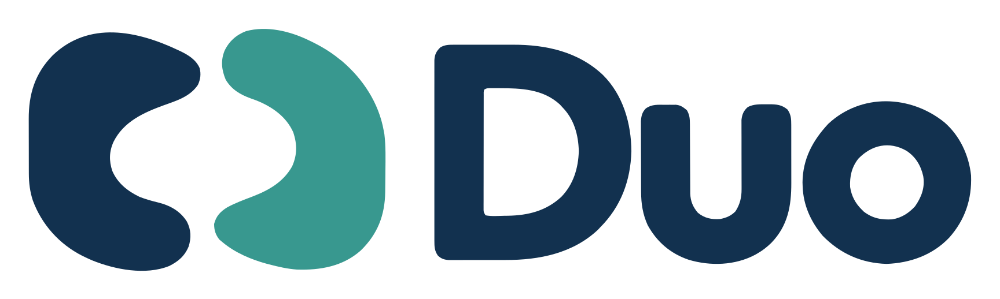

<div align="center">



**Duo-1.0-distill**

**A Reciprocal World Model for Full-Duplex Interaction**

[](https://arxiv.org/abs/2611.15131)
[](https://duo-v1.github.io/)
[](https://huggingface.co/collections/inclusionAI/duo-v1)
[](https://www.modelscope.cn/collections/inclusionAI/Duo-v1)
[](https://github.com/inclusionAI/Duo)

</div>

## Model Overview

Duo is a full-duplex multimodal world model for real-time audio-visual interaction. This repository contains the four-step distilled Realization weights for Duo 1.0.

| Field | Value |
| --- | --- |
| Version | Duo 1.0 |
| Variant | Four-step distilled Realization |
| Package | Realization overlay |
| Realization format | PyTorch Distributed Checkpoint (DCP) |
| Base dependency | `inclusionAI/Duo-1.0-causal-base` |
| Default sampler | Euler, 4 steps, flow shift 5.0 |

## Usage

Download the complete Duo 1.0 causal-base bundle, then overlay these Realization weights into the same directory:

```bash
hf download inclusionAI/Duo-1.0-causal-base --local-dir weights
hf download inclusionAI/Duo-1.0-distill --local-dir weights
```

The shared Intent, codecs, speech models, and Realization backbone are supplied by the causal-base bundle. Runtime integrations can use `realization/complete.json` to identify the distilled model family.

For code, configuration, and runtime-specific integration instructions, see [inclusionAI/Duo](https://github.com/inclusionAI/Duo).

## License

These weights were initialized from MiniMax H3 and subsequently trained by the Duo team. See [LICENSE](./LICENSE) and [NOTICE](./NOTICE) for the applicable terms.
