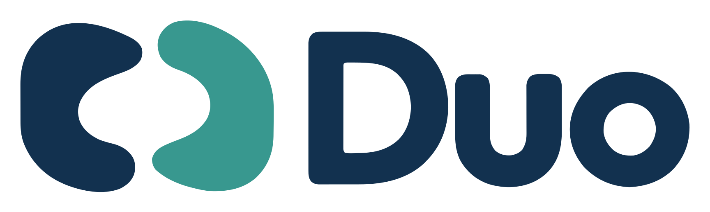

<div align="center">



**Duo-1.2-causal-base**

**A Reciprocal World Model for Full-Duplex Interaction**

[](https://arxiv.org/abs/2611.15131)
[](https://duo-v1.github.io/)
[](https://huggingface.co/collections/inclusionAI/duo-v1)
[](https://www.modelscope.cn/collections/inclusionAI/Duo-v1)
[](https://github.com/inclusionAI/Duo)

</div>

## Model Overview

Duo is a full-duplex multimodal world model for real-time audio-visual interaction. This repository contains the Duo 1.2 causal-base model weights with improved generation quality.

| Field | Value |
| --- | --- |
| Version | Duo 1.2 |
| Variant | Causal base |
| Package | Complete model bundle |
| Realization format | PyTorch Distributed Checkpoint (DCP) |
| Default sampler | Euler, 50 steps, flow shift 1.0 |

## Package Contents

The bundle contains the Realization weights and backbone, Intent model and adapter, video and audio codecs, speech recognizer, and forced aligner. Runtime integrations can use `realization/complete.json` to identify the packaged model family and weight format.

## Download

```bash
hf download inclusionAI/Duo-1.2-causal-base --local-dir weights
```

For code, configuration, and runtime-specific integration instructions, see [inclusionAI/Duo](https://github.com/inclusionAI/Duo).

## License

These weights were initialized from MiniMax H3 and subsequently trained by the Duo team. See [LICENSE](./LICENSE) and [NOTICE](./NOTICE) for the applicable terms.
