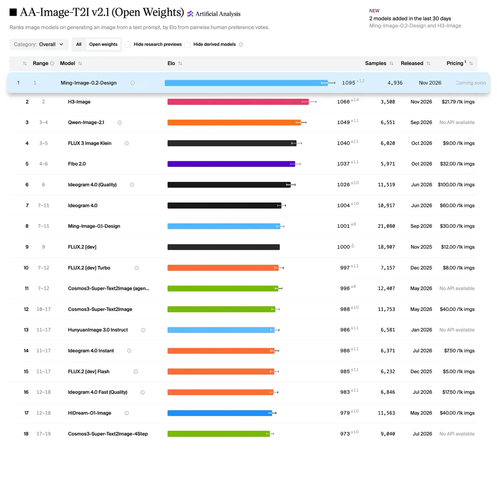
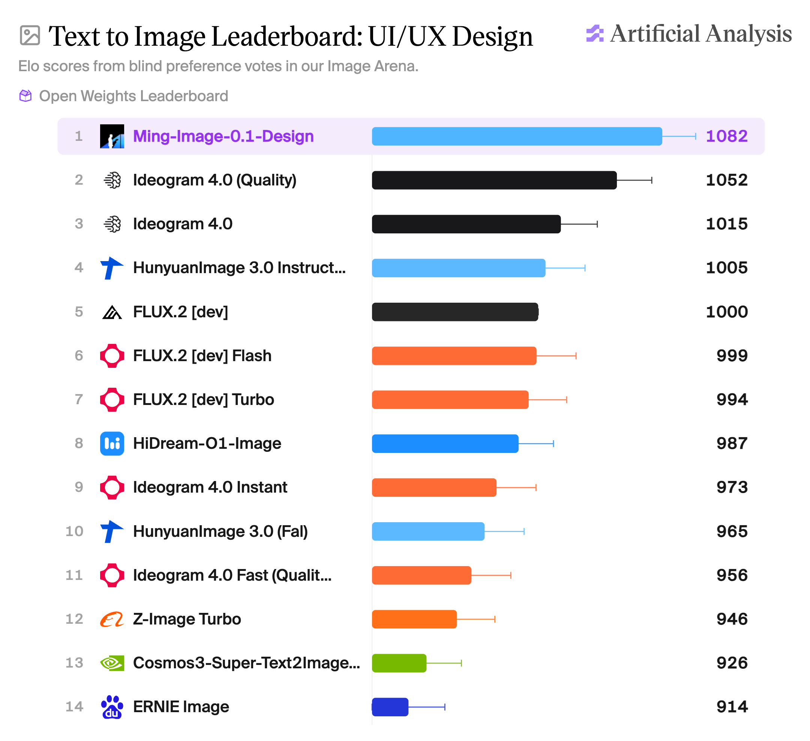

# Ming-Image-0.2-Design

This release upgrades and open-sources Ming-Image-0.2-Design. The new version
improves complex composition, lighting, and text rendering, and can be used to
create e-commerce hero images, UI design drafts, and spatial renderings. The
previous-generation layer decomposition model, Ming-Image-0.1-Design-Layer,
already separates design images into transparent layers. This upgrade further
refines decomposition down to character parts, providing assets for downstream
editing and animation. For web design, Ming-Image-0.2-Design works with
Ling-3.2-flash to turn design concepts into interactive pages.

| Model | Task | Params (DiT) | Weights | Blog | Skills | Demo |
| --- | --- | --- | --- | --- | --- | --- |
| **Ming-Image-0.2-Design** | **Visual-design generation** | 6B | [🤗 Hugging Face](https://huggingface.co/inclusionAI/Ming-Image-0.2-Design) | — | [Design](https://github.com/inclusionAI/ling-cookbook/tree/main/resources/recommended-skills/ling-ui-design) · [PPT](https://github.com/inclusionAI/ling-cookbook/tree/main/resources/recommended-skills/image-to-editable-ppt) | — |
| Ming-Image-0.1-Design | Visual-design generation | 6B | [🤗 Hugging Face](https://huggingface.co/inclusionAI/Ming-Image-0.1-Design) | [Blog](https://mp.weixin.qq.com/s/VGdtxfM8kbHIQJw50VD_Sw) | [Design](https://github.com/inclusionAI/ling-cookbook/tree/main/resources/recommended-skills/ling-ui-design) · [PPT](https://github.com/inclusionAI/ling-cookbook/tree/main/resources/recommended-skills/image-to-editable-ppt) | [Try it](https://huggingface.co/spaces/hugging-apps/ming-image-0-1-design-demo) |
| Ming-Image-0.1-Design-Layer | Editable layer decomposition | 6B | [🤗 Hugging Face](https://huggingface.co/inclusionAI/Ming-Image-0.1-Design-Layer) | [Blog](https://mp.weixin.qq.com/s/VGdtxfM8kbHIQJw50VD_Sw) | [Design](https://github.com/inclusionAI/ling-cookbook/tree/main/resources/recommended-skills/ling-ui-design) · [PPT](https://github.com/inclusionAI/ling-cookbook/tree/main/resources/recommended-skills/image-to-editable-ppt) | [Try it](https://huggingface.co/spaces/Xiaolong-Wang/Ming-Image-0.1-Design-Layer) |

## Leaderboard

Preliminary evaluation results from November 23 show that Ming ranks first
among open-weight models on the overall text-to-image leaderboard.

<table>
  <tr>
    <th width="35%">Model</th>
    <th width="65%"><a href="https://artificialanalysis.ai/image/leaderboard/text-to-image">Artificial Analysis leaderboard</a></th>
  </tr>
  <tr>
    <td valign="top"><strong>Ming-Image-0.2-Design</strong><br>(Latest)</td>
    <td valign="top">
      <strong>#1 among open-weight models overall</strong><br>
      <sub>As of Nov 25, 2026 · AA-Image-T2I v2.1</sub><br>
      <a href="assets/ming-image-0.2-design-aa-t2i-leaderboard.webp"></a>
    </td>
  </tr>
  <tr>
    <td valign="top">Ming-Image-0.1-Design</td>
    <td valign="top">
      #1 among open-weight models in UI/UX Design<br>
      <sub>As of Sep 22, 2026</sub><br>
      <a href="assets/ming-image-design-ui-ux-leaderboard.webp"></a>
    </td>
  </tr>
</table>

## Quick Start

Use the companion [Ming-Image repository](https://github.com/inclusionAI/Ming-Image)
for installation and inference:

```bash
git clone https://github.com/inclusionAI/Ming-Image
cd Ming-Image
pip install -r requirements.txt
```

Natural-language example ([DeepInfra](https://deepinfra.com/blog/ming-design-with-ai)):

```bash
python infer.py \
  --model inclusionAI/Ming-Image-0.2-Design \
  --task text-to-image \
  --prompt "Landing page for a productivity app called Flow. Clean minimal design, white background, generous whitespace. Top navigation with the wordmark 'Flow' on the left and links Product, Pricing, Docs on the right. Centered hero with a bold headline 'Focus without the noise' and a gray subheading 'One calm workspace to plan, focus, and finish.' A single purple call-to-action button labeled 'Start free'. Below the hero, three feature cards with small icons, soft rounded corners and soft shadows. Card 1: title 'Plan your day', body text 'Turn scattered tasks into a clear, realistic plan.' Card 2: title 'Focus sessions', body text 'Start a distraction-free session and stay in flow.' Card 3: title 'See progress', body text 'Know what moved, what slipped, and what comes next.' Modern sans-serif typography. Keep every heading and body line short and legible. Render all text exactly as written. Do not invent additional copy." \
  --width 2048 --height 2048 \
  --output-dir outputs/flow
```

For better results, we recommend a Figma-style structured prompt and its
[prompt enhancer](https://github.com/inclusionAI/Ming-Image#text-to-image-prompt-rewriting).
The four-seasons cabin uses the
[structured prompt file](https://github.com/inclusionAI/Ming-Image/blob/main/assets/t2i_four_seasons_cabin_prompt.json):

```bash
python infer.py \
  --model inclusionAI/Ming-Image-0.2-Design \
  --task text-to-image \
  --prompt assets/t2i_four_seasons_cabin_prompt.json \
  --width 2048 --height 2048 \
  --output-dir outputs/t2i
```

Prompt enhancement (PE) can use `Ling-3.0-flash-VL` or `qwen3.8-27B`; see
[text-to-image prompt rewriting](https://github.com/inclusionAI/Ming-Image#text-to-image-prompt-rewriting).

## Deployment

We recommend the following inference frameworks to serve the model:

- vLLM-Omni: see the [recipes](https://github.com/vllm-project/vllm-omni/blob/main/recipes/inclusionAI/Ming-Image.md)
  and [installation guide](https://docs.vllm.ai/projects/vllm-omni/en/latest/getting_started/quickstart/).

## Recommended settings

- Size (width × height): **2048 × 2048** by default; 2K-level examples are
  **2560 × 1440** (16:9), **2432 × 1824** (4:3), and **1664 × 2496** (2:3).
  Use **1024 × 1024** for faster square generation.
- Sampling steps: **12**.
- CFG scale: **1.0**.
- Precision: **BF16**.
- Hardware: **one CUDA GPU with 80 GiB VRAM** (validated configuration).

Pass `--width` and `--height` together. The code selects an internal 1024- or
2048-level aspect-ratio bucket; arbitrary requested dimensions may receive a
final resize. The older square `--resolution` option remains compatible.

## Gallery

### Ming-Image-0.2-Design

<p align="center">
  <sub>Animated showcase · 4.13 MB · May take a moment to load · <a href="assets/model_cards/ming-image-0.2-design-ecommerce.webp">Open animation</a></sub><br>
  <a href="assets/model_cards/ming-image-0.2-design-ecommerce.webp"></a><br>
  <strong>E-commerce hero visuals</strong><br>
  Fine material detail and clear product information.
</p>

<p align="center">
  <sub>Animated showcase · 2.79 MB · May take a moment to load · <a href="assets/model_cards/ming-image-0.2-design-web-design.webp">Open animation</a></sub><br>
  <a href="assets/model_cards/ming-image-0.2-design-web-design.webp"></a><br>
  <strong>Web design</strong><br>
  Multi-section layouts and a cohesive visual style.
</p>

<p align="center">
  <sub>Animated showcase · 6.53 MB · May take a moment to load · <a href="assets/model_cards/ming-image-0.2-design-spatial-design.webp">Open animation</a></sub><br>
  <a href="assets/model_cards/ming-image-0.2-design-spatial-design.webp"></a><br>
  <strong>Spatial design</strong><br>
  Harmonizing structure, light, and shadow in complex scenes.
</p>

## License

This model is released under the [MIT License](./LICENSE).
