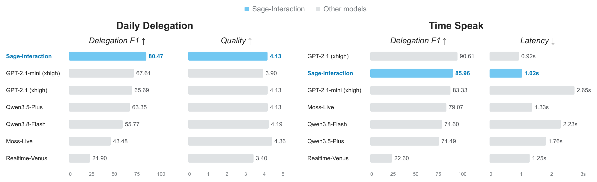

# Sage-Interaction

**An Omni Interaction Model with Agentic Task Delegation**


[GitHub](https://github.com/InternLM/Sage-Interaction) | [Project page](https://internlm.github.io/Sage-Interaction/)

Sage-Interaction is a **9B-parameter omni interaction model** built on MiniCPM-o 4.5. It processes streaming audio and video and generates speech in real time. It can respond to interruptions, resume after brief user acknowledgments or background speech, and react to changes in a live video stream.

The model can delegate longer tasks to a backend while continuing the conversation. The frontend handles real-time interaction, and the backend performs longer reasoning or tool-assisted tasks. When the result arrives, the frontend brings it into the ongoing conversation.

## Evaluation

### Full-Duplex Voice Interaction

FD-Bench v1 measures turn-taking outcome (TOR) and latency. FD-Bench v1.5 measures how the model responds to interruptions and resumes speaking across different conversational scenarios.


### Task Delegation and Timed Reminders



### Streaming Video Understanding and Proactive Response

Charades is reported in mIoU and ProactiveQA in PAUC. The other benchmarks report accuracy.


## Deployment

The voice demo requires Linux, a BF16-capable NVIDIA GPU, Python 3.12, the CUDA 12.8 toolkit, and the system `patch` utility. Task delegation uses a backend API that supports `/models`, `/chat/completions`, and structured JSON output.

### Install and Download

```bash
git clone https://github.com/InternLM/Sage-Interaction.git
cd Sage-Interaction/demo

python3.12 -m venv .venv
source .venv/bin/activate
mkdir -p .cache/tmp
export TMPDIR="$PWD/.cache/tmp" PIP_NO_CACHE_DIR=1
python -m pip install --upgrade pip setuptools wheel packaging ninja
python -m pip install -r requirements.txt
python -m pip install flash-attn==2.8.3 --no-build-isolation
python scripts/prepare_environment.py

python - <<'PY'
from huggingface_hub import snapshot_download

snapshot_download(
    repo_id="internlm/Sage-Interaction",
    local_dir="models/sage-interaction",
)
PY
```

### Configure and Start

Set your backend's API URL and model ID. Replace `/path/to/reference.wav` with the path to your voice-reference WAV file. The launcher prompts for the backend API key without echoing it. For non-interactive startup, set `SAGE_BACKEND_API_KEY` in the environment.

```bash
cp config.example.json config.local.json
export SAGE_BACKEND_BASE_URL="https://your-backend.example.com/v1"
export SAGE_BACKEND_MODEL="your-backend-model"

bash start_demo.sh --config config.local.json --gpu 0 --instances 1 \
  --prompt-wav /path/to/reference.wav
```

When `Demo ready` appears, open `http://127.0.0.1:18080/` in your browser and allow microphone access. The GitHub guide covers remote access and additional launch options. [Deployment guide](https://github.com/InternLM/Sage-Interaction/tree/main/demo#readme)

## Acknowledgments

This work was supported by the Shanghai Artificial Intelligence Laboratory.

We are especially grateful to the developers and maintainers who shared the open-source models and tools that made this work possible. [MiniCPM-o 4.5](https://github.com/OpenBMB/MiniCPM-V) | [Qwen3-TTS](https://github.com/QwenLM/Qwen3-TTS) | [Qwen3-ASR](https://github.com/QwenLM/Qwen3-ASR) | [Whisper](https://github.com/openai/whisper) | [DeepSeek-V4.1-Flash](https://huggingface.co/deepseek-ai/DeepSeek-V4.1-Flash) ｜ [JoyAI-VL-Interaction](https://github.com/jd-opensource/JoyAI-VL-Interaction) and so on. 

## Citation

```bibtex
@misc{sage_interaction,
  title = {Sage-Interaction: An Omni Interaction Model with Agentic Task Delegation},
  howpublished = {GitHub repository},
  url = {https://github.com/InternLM/Sage-Interaction}
}
```
