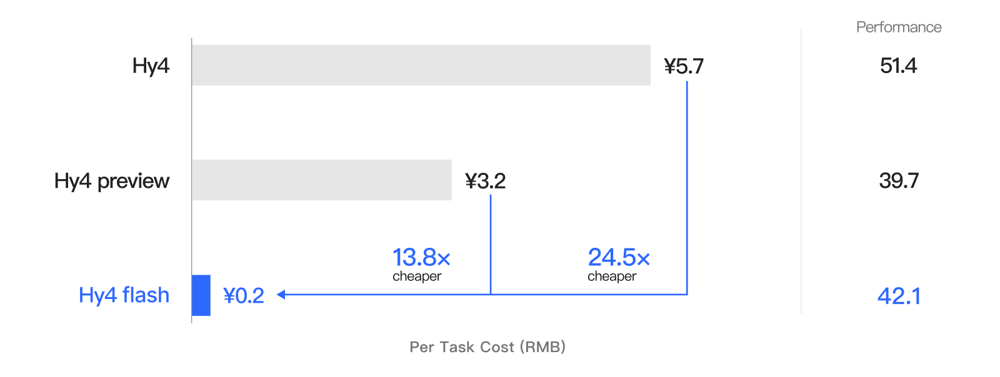
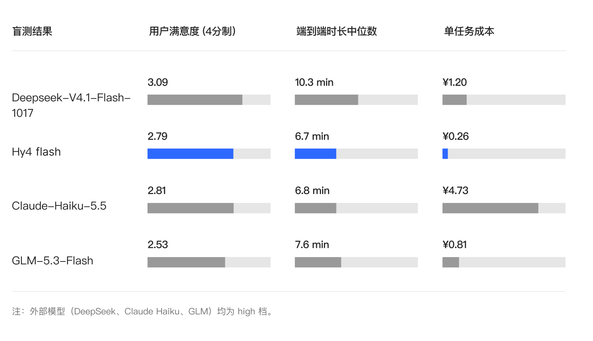

<p align="left">
    <a href="https://huggingface.co/tencent/Hy4-flash">English</a>&nbsp;｜&nbsp;中文
</p>
<br>

<p align="center">
  
</p>

<div align="center" style="line-height: 1;">

[](#许可证)
&nbsp;&nbsp;
[](https://huggingface.co/tencent/Hy4-flash)
&nbsp;&nbsp;
[](https://modelscope.cn/models/Tencent-Hunyuan/Hy4-flash)
&nbsp;&nbsp;
[](https://ai.gitcode.com/tencent_hunyuan/Hy4-flash)

</div>

<p align="center">
  <a href="https://hy.tencent.com/research/hy4-flash?langVersion=zh"><b>官方网站</b></a>&nbsp;&nbsp;|&nbsp;&nbsp;
  <a href="https://github.com/Tencent-Hunyuan/Hy4-flash"><b>GitHub</b></a>&nbsp;&nbsp;|&nbsp;&nbsp;
  <a href="https://huggingface.co/AngelSlim/Hy4-flash-GGUF"><b>GGUF</b></a>
</p>

---

## 目录

- [模型介绍](#模型介绍)
- [预训练模型能力](#预训练模型能力)
- [实用性与成本效率](#实用性与成本效率)
  - [优化思路](#优化思路)
  - [任务效果与成本](#任务效果与成本)
  - [用户盲测](#用户盲测)
- [Benchmark 附录](#benchmark-附录)
- [新闻](#新闻)
- [模型链接](#模型链接)
- [快速开始](#快速开始)
  - [Transformers](#transformers)
  - [OpenAI 兼容 API](#openai-兼容-api)
- [推理和部署](#推理和部署)
  - [DFly2 投机解码](#dfly2-投机解码)
  - [量化工具](#量化工具)
  - [推理框架](#推理框架)
    - [vLLM](#vllm)
    - [SGLang](#sglang)
- [模型微调](#模型微调)
- [许可证](#许可证)
- [联系我们](#联系我们)

## 模型介绍

**Hy4 flash** 是混元系列迄今性价比最高的多模态模型，原生支持文本和图像输入，可生成文本，上下文长度可达 1M token。模型总参数量约为 2200 亿，其中 Engram 约占 640 亿。处理每个 token 时，只需激活约 120 亿个参数。

语言模型主干由 1 层稠密前馈网络和 41 层混合专家网络（MoE）组成，共 42 层。各层通过 identity Hyper-Connections（iHC）传递残差信息。视觉编码器由 SigLIP2-So400m-Patch16-Res512 训练而来，提取的图像特征经 MLP 投影后送入语言模型主干。主干之外还内置了 5 层草稿模型 [DFly2](#dfly2-投机解码)（约 8.5 亿参数），直接复用主模型的 KV cache 与稀疏索引，以固定的低开销支持长上下文投机解码。

相较于 Hy4，Hy4 flash 在架构上有三处主要变化。

1. **混合注意力（Hybrid attention）** 用滑动窗口注意力（SWA）捕捉相邻 token 之间的联系，用 IndexPool 稀疏注意力从更长的上下文中选取相关片段。稀疏注意力与 SWA 以 1:3 的模式交替组合。
2. **LatentMoE** 将 token 的表示从 3072 维投影到 1536 维，让路由专家在更低维的空间里完成计算。每个 MoE 层会为当前 token 从 512 个路由专家中选出 16 个，另有 1 个共享专家参与每个 token 的计算。
3. **Engram（N-gram embedding）** 为模型引入了按需查表的记忆机制。模型根据最近两个或三个 token 的组合，通过多头哈希取出训练中学到的片段表示，并将其融入当前 token 的隐藏状态。

| 规格项 | 取值 |
| --- | --- |
| **模型概览** | |
| Architecture | Mixture-of-Experts (MoE) |
| Total Parameters (excluding Engram, ViT, and DFly2) | 155.5B |
| Engram Parameters | 63.5B |
| ViT Parameters | 0.43B |
| DFly2 Parameters | 0.85B |
| Activated Parameters per Token | Text 11.3B + Vision 0.43B |
| Context Length | 1M (1,048,576 tokens) |
| **语言模型主干** | |
| Backbone Layers | 42 — 1 dense layer and 41 MoE layers |
| Hidden Size | 3,072 |
| Vocabulary Size | 120,832 |
| Residual Connections | iHC (identity Hyper-Connections) with 4 residual streams |
| **混合注意力布局** | |
| Attention Architecture | Sparse attention + sliding-window attention (SWA) |
| Backbone Layer Pattern | 2 × Sparse → 10 × (3 × SWA → Sparse) |
| Attention Formulation | Multi-head Latent Attention (MLA) |
| Multimodal Position Encoding | Interleaved MRoPE |
| **注意力层配置** | **稀疏注意力 / 滑动窗口注意力** |
| Backbone Layers | 12 / 30 |
| Attention Heads | 32 / 64 |
| MLA q_lora_rank | 1,024 / 1,024 |
| MLA kv_lora_rank | 512 / 512 |
| QK Head Dimension (non-RoPE + RoPE) | 192 + 64 / 192 + 64 |
| Value Head Dimension | 256 / 256 |
| RoPE Base | 10,000,000 / 10,000 |
| Sparse Context Selection | Up to 2,048 tokens via group-level selection |
| SWA Context Window | 512-token causal window (511 preceding + current) |
| **前馈网络** | |
| Dense FFN Intermediate Size | 13,824 |
| Routed Experts per MoE Layer | 512 |
| Shared Experts per MoE Layer | 1 |
| Activated Routed Experts per Token | 16 |
| MoE Latent Dimension | 1,536 |
| Expert Intermediate Size | 1,536 |
| **N-gram 嵌入（Engram）** | |
| N-gram Orders | Bigrams and trigrams |
| Backbone Layer Indices (starting from 0) | 1, 11, 21, 31 |
| Hash Heads per N-gram Order | 8 |
| Hash Vocabulary Size per Head | 10.3M |
| Embedding Dimension per N-gram Order | 768 (8 heads × 96 dimensions) |
| Embedding Table Parameters | 63.4B |
| **视觉编码器** | |
| Vision Encoder Layers | 27 |
| Vision Encoder Hidden Size | 1,152 |
| Vision Encoder Intermediate Size | 4,304 |
| Vision Encoder Attention Heads | 16 |
| Vision Patch Size | 16 × 16 |
| Vision Position Embedding Size | 128 × 128 |
| Visual Feature Merging | 2 x 2 |

## 预训练模型能力

内部代码与 Agent 验证集上的 BPB（Bits-per-byte，每字节比特数），数值越低越好：

<p align="center">
  <a href="pretrained-model-bpb.png"></a>
</p>

预训练模型的 few-shot 基准评测结果：

| 类别 | 评测基准 | #Shots | Hy4 flash Base | Hy4 Base | Hy3 preview Base | DeepSeek-V4-flash-Base | DeepSeek-V4-Pro-Base |
| --- | --- | :---: | ---: | ---: | ---: | ---: | ---: |
| **知识** | MMLU† | 5 | 88.7 | **91.6** | 87.5 | 89.7 | 91.1 |
|  | MMLU-Pro† | 5 | 71.1 | **73.9** | 65.8 | 68.6 | 73.4 |
|  | MMLU-Redux† | 5 | 87.6 | **90.6** | 87.0 | 88.8 | 90.2 |
|  | SuperGPQA† | 5 | 57.8 | **62.7** | 52.3 | 52.5 | 54.8 |
|  | C-Eval† | 5 | 92.0 | **95.0** | 90.1 | 91.9 | 93.4 |
|  | CMMLU† | 5 | 91.6 | **93.1** | 89.6 | 89.8 | 90.7 |
|  | SimpleQA | 5 | 37.5 | **57.2** | 26.4 | 31.3 | 52.1 |
|  | Chinese-SimpleQA† | 5 | 74.6 | **83.9** | 69.6 | 71.9 | 76.6 |
|  | AGIEval (English)† | 3 | 75.4 | **79.3** | 76.0 | 76.3 | 78.2 |
|  | AGIEval (Chinese)† | 3 | 90.6 | **91.2** | 87.8 | 88.5 | 89.8 |
| **推理** | HellaSwag (3,000-item subset) | 10 | 85.2 | **87.1** | 85.7 | 85.1 | 86.8 |
|  | PIQA | 4 | 84.4 | **85.3** | 84.6 | 83.8 | 84.9 |
|  | ARC-Challenge | 0 | 95.0 | **97.3** | 96.0 | **97.3** | 97.0 |
|  | Social IQa | 0 | 80.1 | **82.7** | 80.5 | 72.5 | 73.1 |
|  | KOR-Bench | 3 | 54.7 | **57.6** | 54.6 | 53.4 | 55.4 |
|  | C³ | 0 | 77.3 | **82.4** | 75.9 | 74.1 | 78.3 |
| **数学** | U-MATH | 5 | 69.8 | **71.6** | 60.9 | 57.4 | 64.8 |
|  | OCW Courses | 5 | 64.0 | 66.7 | 62.6 | 63.3 | **68.2** |
| **代码** | MBPP-plus | 3 | 73.7 | 74.0 | 77.4 | 76.8 | **79.1** |
| **多语言** | Belebele (5-language subset)† | 5 | 93.8 | 95.0 | 94.2 | 94.4 | **95.2** |
|  | INCLUDE† | 5 | 82.8 | **88.1** | 84.3 | 84.0 | 84.3 |
| **多模态** | MMMU-Pro (Standard, 10 opts) | 4 | 52.0 | **59.6** | — | — | — |
|  | SimpleVQA | 4 | 48.5 | **54.5** | — | — | — |
|  | CVBench | 4 | 83.4 | **86.7** | — | — | — |
|  | RealWorldQA | 4 | 71.1 | **72.3** | — | — | — |
|  | TextVQA | 4 | 73.4 | **78.2** | — | — | — |
|  | CountBenchQA | 4 | 86.6 | **90.6** | — | — | — |

† 标注的文本评测采用宏平均准确率，其余文本评测采用本评测框架报告的准确率。每行最高分以粗体标示；加粗不代表差异具有统计显著性。

多模态结果仅列出 Hy4 flash Base 和 Hy4 Base。

ARC-Challenge 和 HellaSwag 分别使用包含 299 道和 3,000 道题目的子集。INCLUDE 使用覆盖 44 种语言、包含 5,000 个样本的 Lite 子集。Belebele 覆盖德语、韩语、越南语、西班牙语和俄语，共 4,475 个样本。

**免责声明：我们的基座模型在中期训练中使用了大量合成指令数据，因此在 few-shot 评测中偶尔无法遵循预期的答案格式，可能导致得分失真。**

## 实用性与成本效率

### 优化思路

我们通过一系列工作在极致优化成本的同时兼顾智能水平和实用性：

- 在预训练阶段，Hy4 flash 加入了混合注意力、LatentMoE、Engram 等架构特性，KV cache 大小仅为 Hy3 的 **1/24**、Hy4 的 **1/6**，且通过大量 scaling ladder 实验确保效果符合预期；
- 在后训练阶段，我们通过自蒸馏 Hy4 获得了较强的综合智能水平，再通过强化学习使端到端任务输出长度降低 **50%**；
- 在评估阶段，我们构建基于 WorkBuddy 典型任务的内部评测集 WorkIndex，并结合人评，聚焦日常工作的**产物效果、单轮输出长度、端到端用时**，而非远离日常工作的公开榜单分数；
- 在推理阶段，我们结合 megakernel、4bit 量化、[DFly2](#dfly2-投机解码) 等手段极致优化，使 Hy4 flash 解码速度超过 **150 tps**，且可以大规模低成本部署运营。

### 任务效果与成本

**Hy4 flash 的综合任务效果略优于 Hy4 preview，同时显著降低了完成任务的成本。** 在 WorkIndex 上，其得分为 **42.1**，高于 Hy4 preview 的 **39.7**；平均单任务成本仅为 **Hy4 preview 的 1/13、Hy4 的 1/20、DeepSeek-V4.1-Flash-1017 的 1/8**（DeepSeek 按 `max` 档位、忙时价格计算）。

<p align="center">
  <a href="assets/performance-cost-workindex.png"></a>
  <a href="assets/performance-cost-open-benchmarks.png"></a>
</p>
<p align="left"><sub>图 1：内外部任务上的效果与成本。WorkIndex (internal) 包含 8 个内部评测集：PPT 制作、PPT 修改、PPT 人机双写、Markdown 人机双写、文档编辑、表格修复、音视频处理和视觉理解。<br/>Open Benchmarks 包含 7 个公开 Agent 评测集：DeepSWE、ProgramBench、Terminal-Bench 4.0、APEX-Agents、AutomationBench、HLE 和 OSWorld 2.1。</sub></p>

<p align="center">
  <a href="assets/workindex-cost.png"></a>
</p>
<p align="left"><sub>图 2：WorkIndex 平均单任务成本对比；Hy4 flash、Hy4 preview、Hy4 的任务得分分别为 42.1、39.7、51.4。</sub></p>

我们推荐在**深度搜索、文档处理、PPT 制作、简单前端展示和 computer use** 等大部分日常任务中使用 Hy4 flash；对于长程软件工程等复杂任务，仍推荐智能上限更高的 Hy4。

### 用户盲测

**在真实工作任务盲测中，Hy4 flash 的满意度接近 Claude Haiku 5.5，同时在参评模型中实现了最低的单任务成本和最短的任务耗时中位数。** Hy4 flash 的用户满意度为 **2.79/4**（Claude Haiku 5.5 为 **2.81/4**），端到端任务时长中位数为 **6.7 分钟**，单任务成本为 **0.26 元**。

<p align="center">
  <a href="assets/blind-evaluation-zh.png"></a>
</p>
<p align="left"><sub>图 3：85 位 WorkBuddy 内部用户在 27 类、259 个日常工作任务上的盲测结果。</sub></p>

## Benchmark 附录

<p align="center">
  <a href="assets/benchmark.png"></a>
</p>

## 新闻

* 我们在 [Hugging Face](https://huggingface.co/tencent/Hy4-flash)、[ModelScope](https://modelscope.cn/models/Tencent-Hunyuan/Hy4-flash) 和 [GitCode](https://ai.gitcode.com/tencent_hunyuan/Hy4-flash) 开源 **Hy4 flash**、**Hy4 flash-FP8** 和预训练模型 **Hy4 flash-base** 的权重。

## 模型链接

| 模型名 | 简介 | Hugging Face | ModelScope | GitCode |
|:---|:---|:---:|:---:|:---:|
| Hy4 flash | Instruct 模型 | [Model](https://huggingface.co/tencent/Hy4-flash) | [Model](https://modelscope.cn/models/Tencent-Hunyuan/Hy4-flash) | [Model](https://ai.gitcode.com/tencent_hunyuan/Hy4-flash) |
| Hy4 flash-FP8 | FP8 量化 Instruct 模型 | [Model](https://huggingface.co/tencent/Hy4-flash-FP8) | [Model](https://modelscope.cn/models/Tencent-Hunyuan/Hy4-flash-FP8) | [Model](https://ai.gitcode.com/tencent_hunyuan/Hy4-flash-FP8) |
| Hy4 flash-base | 预训练模型 | [Model](https://huggingface.co/tencent/Hy4-flash-base) | [Model](https://modelscope.cn/models/Tencent-Hunyuan/Hy4-flash-base) | [Model](https://ai.gitcode.com/tencent_hunyuan/Hy4-flash-base) |

Hy4 flash-base 为预训练底座，未经过指令微调；下方对话与推理模式示例适用于 Hy4 flash 和 Hy4 flash-FP8。

## 快速开始

可使用 [Transformers](#transformers) 直接加载模型进行本地推理，或部署服务后通过 [OpenAI 兼容 API](#openai-兼容-api) 调用。

> **推理模式（Instruct 模型）**：`reasoning_effort` 支持 `"high"`（默认，启用思考）和 `"no_think"`（直接回复）。以下两个示例均使用 `"no_think"`。
>
> **推荐采样参数**：`temperature=0.9`，`top_p=1.0`。

### Transformers

> Hy4 flash 的支持即将合入 `transformers` 主分支，在此之前请从下面的提交安装。

```bash
pip install "transformers[torch,vision] @ git+https://github.com/huggingface/transformers.git@refs/pull/50903/head"
```

下面以图片描述为例：

```python
from transformers import AutoModelForImageTextToText, AutoProcessor

model_id = "tencent/Hy4-flash"
processor = AutoProcessor.from_pretrained(model_id)
model = AutoModelForImageTextToText.from_pretrained(model_id, device_map="auto")

messages = [
    {
        "role": "user",
        "content": [
            {
                "type": "image",
                "url": "https://huggingface.co/datasets/huggingface/documentation-images/resolve/main/pipeline-cat-chonk.jpeg",
            },
            {"type": "text", "text": "Describe this image in one sentence."},
        ],
    }
]

inputs = processor.apply_chat_template(
    messages,
    add_generation_prompt=True,
    tokenize=True,
    return_dict=True,
    return_tensors="pt",
    reasoning_effort="no_think",
).to(model.device)

outputs = model.generate(**inputs, max_new_tokens=256)
print(processor.decode(outputs[0, inputs["input_ids"].shape[1] :], skip_special_tokens=True))
```

### OpenAI 兼容 API

选择 API 调用时，先按 [vLLM 部署说明](#vllm) 启动服务，再运行以下客户端示例：

```python
from openai import OpenAI

client = OpenAI(base_url="http://127.0.0.1:8000/v1", api_key="EMPTY")

response = client.chat.completions.create(
    model="hy4-flash",
    messages=[
        {"role": "user", "content": "你好！请简单介绍一下你自己。"},
    ],
    temperature=0.9,
    top_p=1.0,
    extra_body={"chat_template_kwargs": {"reasoning_effort": "no_think"}},
)
print(response.choices[0].message.content)
```

## 推理和部署

### DFly2 投机解码

DFly2 是基于 [AngelSpec](https://github.com/Tencent/AngelSpec) 框架训练的 Hy4 flash 投机解码草稿模型，直接复用主模型的 **Top-k Sparse KV**：每个 draft 层与主模型对应的稀疏注意力层共享 KV cache（**KV Share**）及压缩索引器选出的最多 2,048 个位置（**Index Share**）。由此带来三点优势：

- **计算开销固定**：每个草稿 token 至多关注约 2K 个 key，注意力复杂度与上下文长度无关。
- **零额外 KV 显存**：无需维护草稿模型独立的 KV cache。
- **适配 PD 分离**：不参与 prefill，P→D 仅额外传输一个末层隐状态。

<p align="center">
  <a href="assets/dfly2.png"></a>
</p>

### 量化工具

我们提供了 [AngelSlim](https://github.com/tencent/AngelSlim)——一套易用、全面、高效的大模型压缩工具包，涵盖常用量化算法、低比特量化和投机采样等能力。

对于本模型我们提供了[GGUF](https://huggingface.co/AngelSlim/Hy4-flash-GGUF) 压缩版本以供端测使用。

### 推理框架

对于生产环境部署，我们建议使用 [vLLM](https://github.com/vllm-project/vllm) 或 [SGLang](https://docs.sglang.io/)。请参考部署方案：
- [Hy4 flash vLLM Recipe](https://recipes.vllm.ai/tencent/Hy4-flash)
- [Hy4 flash SGLang Cookbook](https://docs.sglang.io/cookbook/autoregressive/Tencent/Hy4-flash)


#### vLLM

使用社区官方镜像 `vllm/vllm-openai:hy4-flash` 部署：

```bash
docker run --gpus all \
  -p 8000:8000 \
  --ipc=host \
  -v ~/.cache/huggingface:/root/.cache/huggingface \
  vllm/vllm-openai:hy4-flash tencent/Hy4-flash-FP8 \
    --tensor-parallel-size 8 \
    --speculative-config '{"num_speculative_tokens":5,"method":"dfly"}' \
    --attention-backend FLASHMLA_SPARSE \
    --tool-call-parser hy_v4 \
    --reasoning-parser hy_v4 \
    --enable-auto-tool-choice \
    --port 8000 \
    --served-model-name hy4-flash
```


#### SGLang

使用社区官方镜像 `lmsysorg/sglang:hy4-flash` 部署，（支持 x86 和 Arm）。

```bash
docker pull lmsysorg/sglang:hy4-flash

docker run --gpus all \
  -p 8000:8000 \
  --ipc=host \
  lmsysorg/sglang:hy4-flash \
  sglang serve \
    --trust-remote-code \
    --model-path tencent/Hy4-flash-FP8 \
    --tp 8 \
    --cuda-graph-backend-prefill disabled \
    --speculative-algorithm DFLY \
    --speculative-dfly-block-size 6 \
    --host 127.0.0.1 \
    --port 8000
```

## 模型微调

Hy4 flash 提供了完整的模型微调流程，详细的微调文档请参考：[模型微调指南](https://huggingface.co/tencent/Hy4-flash/blob/main/finetune/README_CN.md)

## 许可证

Hy4 flash 基于 **Tencent Hy License** 发布。详情请参阅 [LICENSE](https://huggingface.co/tencent/Hy4-flash/blob/main/LICENSE)。

## 联系我们

如有问题或建议，欢迎通过邮件联系我们的研发和产品团队：

📧 **hunyuan_opensource@tencent.com**

---

<p align="center">
  <i>Hy4 flash 由腾讯混元团队研发。</i>
</p>
