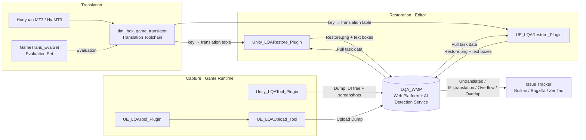

<div align="center">  
  <a href="./README.md">简体中文</a> · <strong>English</strong>  
</div>

# TiMiHOKGameTranslator · Open-Source Game Localization Translation and Automated LQA Toolkit

  

**TiMiHOKGameTranslator** is open-sourced by the *Honor of Kings project team at TiMi L1 Studio, Tencent Games*. Built for multilingual game releases, it tackles localization-specific problems such as **text overflow, untranslated strings, and inconsistent in-game terminology**, and greatly improves the efficiency of AI translation ingestion and LQA before human translators step in for review. It covers the complete pipeline from **AI translation** to **Localization Quality Assurance (LQA)**:

- **Translation**: AI translation toolchain for game text + multi-genre game translation evaluation set
- **Capture**: Unity / UE runtime plugins that export the UI node tree, text, localization keys, and screenshots in one click
- **Restoration**: Re-render captured results in any target language inside the editor to surface untranslated strings, mistranslations, text overflow, and overlapping text early
- **Platform**: LQA web management platform and AI detection service; file issues from review results with one click, with regression verification after fixes

> ### ✅ Hunyuan MT3 Integration
> 
> The translation pipeline has been adapted for **Tencent Hunyuan translation model Hy-MT3 (Hunyuan MT3)**.  
> Model repository: **<https://huggingface.co/collections/tencent/hy-mt3>**

---

## Sub-Repositories

| Repository                                                                                                                                      | Type        | Description                                                                       |
| ----------------------------------------------------------------------------------------------------------------------------------------------- | ----------- | --------------------------------------------------------------------------------- |
| [TiMi\_HOK\_Game\_Translator](https://huggingface.co/tencent/TiMiHOKGameTranslator/tree/main/timi_hok_game_translator/TiMi_HOK_Game_Translator) | Translation | Translation toolchain (adapted for Hunyuan MT3)                                   |
| [GameTrans\_EvalSet](https://huggingface.co/tencent/TiMiHOKGameTranslator/tree/main/timi_hok_game_translator/GameTrans_EvalSet)                 | Evaluation  | Open evaluation set for game translation                                          |
| [Unity\_LQATool\_Plugin](https://huggingface.co/tencent/TiMiHOKGameTranslator/tree/main/timi_hok_game_translator/Unity_LQATool_Plugin)          | Capture     | LQA capture plugin for Unity                                                      |
| [Unity\_LQARestore\_Plugin](https://huggingface.co/tencent/TiMiHOKGameTranslator/tree/main/timi_hok_game_translator/Unity_LQARestore_Plugin)    | Restoration | LQA restoration plugin for Unity                                                  |
| [UE\_LQATool\_Plugin](https://huggingface.co/tencent/TiMiHOKGameTranslator/tree/main/timi_hok_game_translator/UE_LQATool_Plugin)                | Capture     | LQA capture plugin for Unreal Engine                                              |
| [UE\_LQAUpload\_Tool](https://huggingface.co/tencent/TiMiHOKGameTranslator/tree/main/timi_hok_game_translator/UE_LQAUpload_Tool)                | Capture     | Upload tool for Unreal Engine LQA capture data                                    |
| [UE\_LQARestore\_Plugin](https://huggingface.co/tencent/TiMiHOKGameTranslator/tree/main/timi_hok_game_translator/UE_LQARestore_Plugin)          | Restoration | LQA restoration plugin for Unreal Engine                                          |
| [LQA\_WMP](https://huggingface.co/tencent/TiMiHOKGameTranslator/tree/main/timi_hok_game_translator/LQA_WMP)                                     | Platform    | Web management platform and services for LQA (including the AI detection service) |

---

## Architecture



**Core idea: capture the Chinese baseline once, then restore any target language.** The capture side only records the text actually displayed in-game and its localization key — no translation is performed. The restoration side looks up the translation table by target language and re-renders the screen in the editor, then hands it to the platform's AI service for detection. This removes the need to re-run the game and re-capture screenshots for every single language.

---

## Modules

### 1. Translation Toolchain · `timi_hok_game_translator`

An AI translation toolchain for game text, **already adapted for Hunyuan MT3 ([Hy-MT3](https://huggingface.co/collections/tencent/hy-mt3))**. The Hunyuan translation model family supports mutual translation across 33 languages and follows instructions for terminology intervention, style control, delimiter preservation, and structured-data (JSON / XML) translation — well suited to the many placeholders, rich-text tags, and proper nouns found in game text. The resulting `key → translation` table can be consumed directly by the restoration plugins.

### 2. Evaluation Set · `GameTrans_EvalSet`

An open evaluation set for game-scenario translation, containing **4,500** Chinese source entries across **15 game genres**:

| Genre           | Count | Genre              | Count | Genre                   | Count |
| --------------- | ----- | ------------------ | ----- | ----------------------- | ----- |
| MOBA            | 410   | MMO                | 324   | Horror                  | 293   |
| Casual & Puzzle | 333   | Fighting           | 315   | Racing                  | 290   |
| Open World      | 333   | Action & Adventure | 309   | Sandbox                 | 289   |
| Shooter         | 306   | RPG                | 305   | Simulation / Management | 286   |
| SLG             | 276   | Chinese-style      | 255   | Board & Card            | 176   |

Each entry comes with a **glossary for 14 target locales**: en / vi / th / id / zh-Hant / fr / de / ru / ja / pt-BR / ko / ar / es / tr, so you can evaluate terminology adherence and translation quality.

### 3. LQA Capture

| Plugin                 | Engine | Platform                    | Key Capabilities                                                                                                                                                                                                                                                                                                        |
| ---------------------- | ------ | --------------------------- | ----------------------------------------------------------------------------------------------------------------------------------------------------------------------------------------------------------------------------------------------------------------------------------------------------------------------- |
| `Unity_LQATool_Plugin` | Unity  | Win64 / Mac / iOS / Android | Always resident at runtime; one-click Dump via a floating button or **F9**; outputs a text-containing screenshot and a text-free background image from the same frame; uses text-ID coloring plus pixel differencing to determine whether each text segment is actually visible; supports long-press to pick text nodes |
| `UE_LQATool_Plugin`    | Unreal | Win64 / Mac / iOS / Android | Run `r.EnableLQATool 1` to open the panel; Dump a widget-tree snapshot (hierarchy, coordinates, styles, text, localization keys); right-click **GetKey** to look up a text key; includes a pure C++ test gallery with 11 categories of display-bug samples                                                              |
| `UE_LQAUpload_Tool`    | Unreal | Python                      | Config-driven: scans Dump directories, converts snapshot JSON into the platform format, and uploads entries one by one                                                                                                                                                                                                  |

### 4. LQA Restoration

| Plugin                    | Engine       | Key Capabilities                                                                                                                                                                                                                                                                            |
| ------------------------- | ------------ | ------------------------------------------------------------------------------------------------------------------------------------------------------------------------------------------------------------------------------------------------------------------------------------------- |
| `Unity_LQARestore_Plugin` | Unity Editor | Menu entry `Tools/LQA/`: restore a screen from a Dump, replace translations, switch font variants, and manually correct text visibility; output `Restore.png` and `rect_locations.json`; can connect to the platform and automatically loop through “monitor → download → restore → submit” |
| `UE_LQARestore_Plugin`    | Unreal       | Reads Dump JSON, dynamically rebuilds the UI, and replaces text with multilingual strings                                                                                                                                                                                                   |

Both engines use the same integration model — **generic core + project-specific adapters**. Generic components work out of the box; for a project's own localization and rich-text components, you only need to register one extractor on the capture side and one restorer on the restoration side, without modifying the core.

### 5. LQA Platform · `LQA_WMP`

| Capability          | Description                                                                                                                                                                         |
| ------------------- | ----------------------------------------------------------------------------------------------------------------------------------------------------------------------------------- |
| Accounts & Projects | Multi-project isolation; roles include super admin, project admin, tester, and developer; supports API access_token                                                                 |
| Restoration Tasks   | Create tasks, choose languages and test data, and trigger the restoration plugins via Webhook (Jenkins / GitLab CI / self-hosted service)                                           |
| AI Detection        | After screenshots are uploaded, asynchronously detects **untranslated text, mistranslations, overflow, missing keys, and overlap**; pluggable OCR adapter layer (9 implementations) |
| Defect Management   | Optional built-in tracking, Bugzilla 5.x, or ZenTao; supports single, batch, and automatic issue creation, plus regression verification                                             |

Tech stack: Python 3.12 + Django 5.1 + Celery + MySQL 8 + Redis 7｜Vue 3 + Vite 5 + Element Plus｜Flask detection service｜Docker Compose one-command deployment.

---

## Quick Start

```bash
# 1. Deploy the platform
git clone https://github.com/TiMiHOKGameTranslator/LQA_WMP.git
cd LQA_WMP && cp .env.example .env && docker compose up -d

# 2. Integrate a capture plugin into your game project (choose one)
#    Unity: place Unity_LQATool_Plugin under Assets/, enable it, and press F9 to Dump
#    UE: copy Plugins/LQATool into your project's Plugins/, run r.EnableLQATool 1 at runtime

# 3. Integrate the restoration plugin in the editor; configure platform Host / JWT / Project ID / Task ID
#    Unity: Tools/LQA/Platform/Config/...

# 4. Use the Hunyuan MT3 translation toolchain to generate a key → translation table,
#    then specify it under “Translation File Configuration” in the restoration plugin

# 5. Pull task → restore → submit; review and file issues after platform AI detection
```

For detailed integration steps, configuration options, and FAQs of each module, see the README in the corresponding sub-repository.

---

## Typical Workflow

1. **Capture**: QA engineers open the LQA capture tool in-game, Dump each screen, and obtain the Chinese baseline
2. **Upload**: Unity uses the upload feature in the restoration plugin; UE uses `UE_LQAUpload_Tool` to upload Dumps to the LQA platform
3. **Translate**: Produce translation tables for each locale with the Hunyuan MT3-adapted toolchain
4. **Restore**: The editor pulls task data, re-renders in the target language, and outputs restored images and text boxes
5. **Detect**: The platform's AI service compares results and flags untranslated text, mistranslations, overflow, and overlap
6. **Close the loop**: After QA review, file issues to the defect system with one click, then trigger regression verification after fixes

---

## Main Authors

Shijia Wen, Jianwei Wu, Lizhi Fang, Sijia Wang, Zhongfu Zheng, Jing Zhao, Weiwei Xun, Yutong Li, Hengjian Long, Hanxin Liu, Dawei Wu, Jia Qing, Kaiyou He, Youning Liang, Shicen Liu

---

---

## Contributing

Issues and Pull Requests / Merge Requests are welcome. Please read the README and contribution guidelines of each sub-repository first (e.g. `LQA_WMP/CONTRIBUTING.md`), and follow each repository's existing code style (e.g. `.clang-format` in the UE plugins).

## License

This project is open-sourced under the **Apache License 2.0**; the LICENSE file of each sub-repository takes precedence.

## Acknowledgements

- [Tencent Hunyuan Hy-MT3](https://huggingface.co/collections/tencent/hy-mt3): for providing the translation model capability
