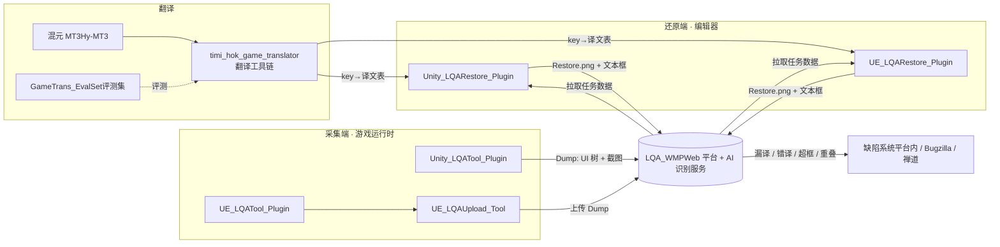

<div align="center">
  <strong>简体中文</strong> · <a href="./README.en.md">English</a>
</div>

# TiMi峡谷游译官TiMiHOKGameTranslator · 游戏本地化翻译与自动化测试开源工程

  

**TiMiHOKGameTranslator** 由 *腾讯游戏 天美L1工作室 王者荣耀项目组* 开源，面向游戏出海多语言版本，解决游戏翻译领域特有的「**超框、漏译、游戏专有名词不一致**」等问题，极大提高人工翻译校注介入前的AI翻译入库/LQA效率，覆盖从「**AI 翻译**」到「**本地化质量检查（LQA）**」的完整链路：

- **翻译**：游戏文本 AI 翻译工具链 + 多品类游戏翻译评测集
- **采集**：Unity / UE 运行时插件，一键导出 UI 节点树、文本、本地化 Key 和截图
- **还原**：在编辑器里把采集结果按任意目标语言重新渲染，提前暴露漏译、错译、超框、重叠等问题
- **平台**：LQA Web 管理平台和 AI 识别服务，审核结果一键提单，修复后支持回归验证

> ### ✅ 混元 MT3 已适配
> 
> 本工程的翻译链路已适配 **腾讯混元翻译模型 Hy-MT3（混元 MT3）**。
> 模型仓库：**<https://huggingface.co/collections/tencent/hy-mt3>**

---

## 子仓库一览

| 仓库  | 类型  | 说明  |
| --- | --- | --- |
| [TiMi_HOK_Game_Translator](https://huggingface.co/tencent/TiMiHOKGameTranslator/tree/main/timi_hok_game_translator/TiMi_HOK_Game_Translator) | 翻译  | 翻译工具链（已适配混元 MT3） |
| [GameTrans_EvalSet](https://huggingface.co/tencent/TiMiHOKGameTranslator/tree/main/timi_hok_game_translator/GameTrans_EvalSet) | 评测  | 游戏翻译开源评测集 |
| [Unity_LQATool_Plugin](https://huggingface.co/tencent/TiMiHOKGameTranslator/tree/main/timi_hok_game_translator/Unity_LQATool_Plugin) | 采集端 | Unity 引擎的 LQA 采集插件 |
| [Unity_LQARestore_Plugin](https://huggingface.co/tencent/TiMiHOKGameTranslator/tree/main/timi_hok_game_translator/Unity_LQARestore_Plugin) | 还原端 | Unity 引擎的 LQA 还原插件 |
| [UE_LQATool_Plugin](https://huggingface.co/tencent/TiMiHOKGameTranslator/tree/main/timi_hok_game_translator/UE_LQATool_Plugin) | 采集端 | UE 引擎的 LQA 采集插件 |
| [UE_LQAUpload_Tool](https://huggingface.co/tencent/TiMiHOKGameTranslator/tree/main/timi_hok_game_translator/UE_LQAUpload_Tool) | 采集端 | UE 引擎的 LQA 采集数据上传工具 |
| [UE_LQARestore_Plugin](https://huggingface.co/tencent/TiMiHOKGameTranslator/tree/main/timi_hok_game_translator/UE_LQARestore_Plugin) | 还原端 | UE 引擎的 LQA 还原插件 |
| [LQA_WMP](https://huggingface.co/tencent/TiMiHOKGameTranslator/tree/main/timi_hok_game_translator/LQA_WMP) | 平台  | LQA 服务的 Web 管理平台及配套服务（含 AI 识别服务） |

---

## 整体架构



**核心思路：采集一次中文基线，就能还原任意目标语言。** 采集端只记录游戏当前实际显示的文本和本地化 Key，不做翻译；还原端在编辑器里按目标语言查译文表、重新渲染画面，再交给平台的 AI 服务检测。这样不必为每个语种重新跑一遍游戏、重新截图。

---

## 模块介绍

### 1. 翻译工具链 · `timi_hok_game_translator`

游戏文本的 AI 翻译工具链，**已适配混元 MT3（[Hy-MT3](https://huggingface.co/collections/tencent/hy-mt3)）**。混元翻译模型系列支持 33 种语言互译，具备术语干预、风格控制、分隔符保留、结构化数据（JSON / XML 等）翻译等指令遵循能力，适合游戏文本里大量的占位符、富文本标签和专有名词。产出的 `key→译文` 表可以直接给还原端使用。

### 2. 评测集 · `GameTrans_EvalSet`

面向游戏场景的翻译开源评测集，共 **4500 条** 中文源文，覆盖 **15 个游戏品类**：

| 品类  | 条数  | 品类  | 条数  | 品类  | 条数  |
| --- | --- | --- | --- | --- | --- |
| MOBA | 410 | MMO | 324 | 恐怖  | 293 |
| 休闲益智 | 333 | 格斗  | 315 | 竞速  | 290 |
| 大世界 | 333 | 动作冒险 | 309 | 沙盒  | 289 |
| 射击游戏 | 306 | RPG | 305 | 模拟经营 | 286 |
| SLG | 276 | 国风  | 255 | 棋牌  | 176 |

每条数据都附带 **14 个目标语种的术语表**：en / vi / th / id / zh-Hant / fr / de / ru / ja / pt-BR / ko / ar / es / tr，可用来评测术语遵循和翻译质量。

### 3. LQA 采集端

| 插件  | 引擎  | 平台  | 核心能力 |
| --- | --- | --- | --- |
| `Unity_LQATool_Plugin` | Unity | Win64 / Mac / iOS / Android | 运行时自动常驻，用悬浮按钮或 **F9** 一键 Dump；同帧输出含文本图和无文本背景图；用文本 ID 染色图加像素差分判断每段文本是否真正可见；支持长按拾取文本节点 |
| `UE_LQATool_Plugin` | Unreal | Win64 / Mac / iOS / Android | 执行 `r.EnableLQATool 1` 打开面板；Dump 控件树快照（层级、坐标、样式、文本、本地化 Key）；用右键 **GetKey** 查文本 Key；自带纯 C++ 测试画廊（含 11 类显示 BUG 样例） |
| `UE_LQAUpload_Tool` | Unreal | Python | 由配置文件驱动，扫描 Dump 目录，把快照 JSON 整理成平台格式后逐条上传 |

### 4. LQA 还原端

| 插件  | 引擎  | 核心能力 |
| --- | --- | --- |
| `Unity_LQARestore_Plugin` | Unity Editor | 菜单入口为 `Tools/LQA/`：从 Dump 还原画面，支持译文替换、字体变体、人工修正文本显隐；输出 `Restore.png` 和 `rect_locations.json`；可对接平台，自动循环执行「监控 → 下载 → 还原 → 提交」 |
| `UE_LQARestore_Plugin` | Unreal | 读取 Dump JSON，动态重建 UI 界面并替换多语言文本 |

两种引擎的接入方式一致，都是「**通用内核 + 项目专属适配**」：通用组件开箱即用；项目自己的本地化组件和富文本组件，只需在采集端和还原端分别注册一个提取器或还原器，不改内核。

### 5. LQA 平台 · `LQA_WMP`

| 能力  | 说明  |
| --- | --- |
| 账号与项目 | 多项目隔离；角色分为超级管理员、项目管理员、测试人员、开发人员；支持 API access_token |
| 还原任务 | 创建任务、选择语言和测试数据，通过 Webhook（Jenkins / GitLab CI / 自建服务）触发还原端 |
| AI 识别 | 截图上传后异步识别 **漏译、错译、超框、漏 Key、重叠**；OCR 适配层可插拔（9 种实现） |
| 缺陷管理 | 可选平台内记录、Bugzilla 5.x 或禅道；支持单个、批量、自动提单，以及回归验证 |

技术栈：Python 3.12 + Django 5.1 + Celery + MySQL 8 + Redis 7｜Vue 3 + Vite 5 + Element Plus｜Flask 识别服务｜Docker Compose 一键部署。

---

## 快速开始

```bash
# 1. 部署平台
git clone https://huggingface.co/tencent/TiMiHOKGameTranslator/tree/main/timi_hok_game_translator/LQA_WMP
cd LQA_WMP && cp .env.example .env && docker compose up -d

# 2. 游戏工程接入采集插件（二选一）
#    Unity：把 Unity_LQATool_Plugin 放到 Assets/ 下，开启后按 F9 Dump
#    UE   ：把 Plugins/LQATool 复制到工程 Plugins/，运行时执行 r.EnableLQATool 1

# 3. 编辑器接入还原插件，配置平台 Host / JWT / 项目 ID / 任务 ID
#    Unity：Tools/LQA/平台/配置/...

# 4. 用混元 MT3 翻译工具链生成 key→译文 表，在还原端「译文文件配置」中指定

# 5. 拉取任务 → 还原 → 提交；平台 AI 识别后审核、提单
```

各模块的详细接入步骤、配置项和常见问题，请看对应子仓库的 README。

---

## 典型工作流

1. **采集**：测试同学在游戏里打开 LQA 采集工具，逐个界面 Dump，得到中文基线
2. **上传**：Unity 用还原插件里的上传功能，UE 用 `UE_LQAUpload_Tool`，把 Dump 上传到 LQA 平台
3. **翻译**：用适配了混元 MT3 的翻译工具链产出各语种译文表
4. **还原**：编辑器拉取任务数据，按目标语言重新渲染，输出还原图和文本框
5. **检测**：平台 AI 识别服务比对后，标出漏译、错译、超框、重叠等问题
6. **闭环**：测试审核后一键提单到缺陷系统，修复后发起回归验证

---

## 主要作者

文施嘉、吴建伟、方李志、王思嘉、郑仲富、赵菁、寻微微、李雨桐、龙恒建、刘汉鑫、吴大维、卿佳、何开有、梁有宁、刘师岑

---

## 贡献

欢迎提交 Issue 和 Merge Request。请先阅读各子仓库的 README 和贡献指南（如 `LQA_WMP/CONTRIBUTING.md`），代码风格以各仓库已有规范为准（如 UE 插件的 `.clang-format`）。

## 许可证

本工程以 **Apache License 2.0** 开源，具体以各子仓库的 LICENSE 文件为准。

## 致谢

- [腾讯混元 Hy-MT3](https://huggingface.co/collections/tencent/hy-mt3)：提供翻译模型能力