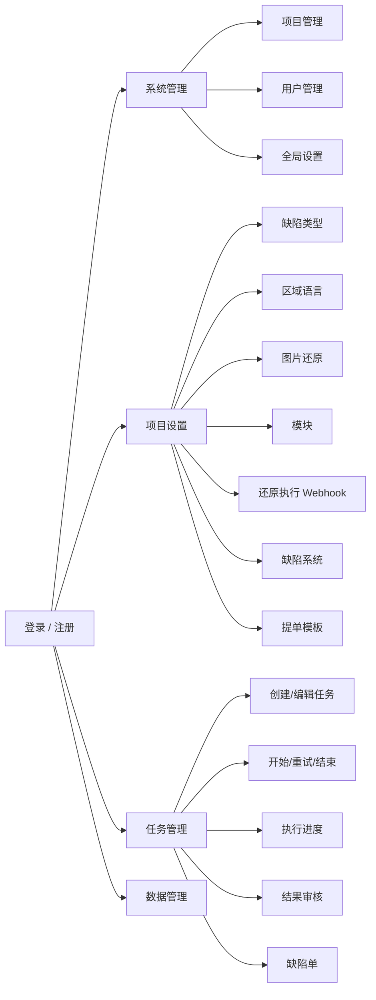
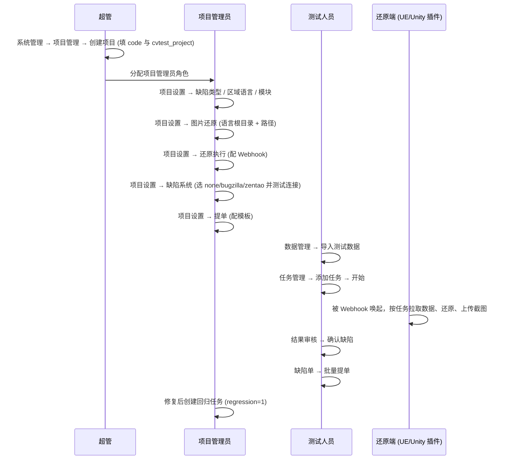

# LQA Web 平台使用文档

本手册面向 **测试工程师 / 项目管理员 / 开发同学**, 介绍如何通过 LQA Web 平台 (以下简称 “平台”) 完成本地化质量检查的日常工作: 从登录、创建项目、配置还原端与缺陷系统, 到执行还原任务、审核 AI 识别结果、提交并回归验证缺陷

> 平台默认访问地址: `http://<服务器IP>:8080` (由 `.env` 中 `LQA_HTTP_PORT` 决定, 默认 `8080`), 
> 部署与运维相关内容请参阅项目根 [README.md](../README.md)

---

## 1. 概览

### 1.1 功能地图



### 1.2 角色

| 角色 | 可见菜单 | 典型操作 |
|---|---|---|
| **超级管理员** | 系统管理 (项目/用户/全局设置) + 所有项目 | 创建项目、创建/禁用用户、全局配置 |
| **项目管理员** | 自己的项目下 全部菜单 | 配置 Webhook/缺陷系统、建任务、建缺陷类型 |
| **测试人员** | 任务管理、数据管理、结果审核、缺陷单 | 跑任务、审核结果、提单、回归 |
| **开发人员** | 任务管理 (只读)、缺陷单 | 查看任务、处理缺陷 |

> 角色由 **超级管理员** 在 “项目设置 → 用户管理” 中为用户在具体项目下分配, 一个用户可同时在多个项目中拥有不同角色

### 1.3 顶部与左侧导航

- **左侧菜单**: 按当前选中的项目动态生成, 顶部切换项目后, 整个左侧菜单会刷新为该项目下的功能
- **顶部项目选择器**: 切换项目视角; **系统管理** 视角独立, 用于全局配置
- **右上角头像**: 个人信息、修改密码、退出登录

---

## 2. 账号与登录

### 2.1 登录

1. 浏览器访问平台地址, 输入用户名与密码
2. 平台支持自助注册 (由 `.env` 中 `ALLOW_REGISTER` 控制, 默认开启), 注册后账号默认无任何项目权限, 需由超级管理员到 “系统管理 → 用户管理” 中分配项目角色
3. 忘记密码请联系超级管理员, 在用户管理页面点击 “重置密码”

### 2.2 自助注册

- 登录页右下角若出现 **注册账号** 入口即为开放注册状态
- 注册流程: 填写 **用户名 / 中文名 / 所属部门 / 密码 / 确认密码** → 提交, 无需邮件验证, 注册后请联系管理员分配项目

### 2.3 修改密码 / 退出登录

- 点击右上角头像 → **修改密码**: 需要输入原密码
- 退出登录: 点击头像 → **退出登录**

---

## 3. 系统管理 (超级管理员)

### 3.1 项目管理 (`系统管理 → 项目管理`)

用于创建和维护所有项目, 字段说明:

| 字段 | 必填 | 说明 |
|---|---|---|
| 所属团队 | 否 | 用于分组标识 |
| 名称 | 是 | 项目中文名 |
| 项目代号 (code) | 是 | 英文代号, `[A-Za-z0-9_-]{2,100}`, **创建后不可修改**; 用于提单模板目录 `templates/spec2/<代号小写>` |
| AI 识别项目名 (cvtest_project) | 是 | AI 识别服务中的项目标识, 调用时拼成 `<项目名>_lqa` 作为 `project-method`, 未填写时 **无法创建任务** |
| 项目类型 | 是 | 平台级 / 项目级 (默认项目级) |
| 游戏类型 | 是 | 多选：手游 / 端游 / 页游 / app / 小游戏 |
| 研发阶段 | 是 | 上线运营 / 下线 / 研发期 / 保密 |
| 测试经理 | 是 | 平台用户名; 创建项目后会自动赋予 “项目管理员” 角色, 多人以 `;` 分隔 |

> 创建完成后, 顶部项目选择器会出现新项目, 切换过去即可进入该项目的功能菜单

### 3.2 用户管理 (`系统管理 → 用户管理`)

- **全局视角**: 可按 `英文名 / 中文名 / 所属部门 / 所属项目 / 是否管理员` 搜索; 可新增用户、重置密码、禁用账号
- **按项目视角**: 进入某个项目的 `项目设置 → 用户管理`, 这里的新增/编辑作用于当前项目的角色分配
- 支持 **导出用户列表 CSV** (右上角 “导出” 按钮), 角色会翻译成 `项目名/角色名` 的可读文本

字段:

| 字段 | 说明 |
|---|---|
| 英文名 | 唯一标识, 创建后不可改 |
| 中文名 / 所属部门 | 用户自助注册时填写, 管理员可改 |
| 角色 | 多选, 格式 `项目/角色`, 使用级联选择器 |

### 3.3 全局设置 (`系统管理 → 设置`)

- 调整系统级别开关、全局提示等 (具体项按部署版本不同略有差异)

---

## 4. 项目设置 (项目管理员)

进入某个项目后, 左侧菜单会出现 **项目设置**, 分为以下 Tab:

> 不同角色可见的 Tab 不同, 普通测试人员只能看到 **模块** 和 **提单**

### 4.1 缺陷类型

维护项目的缺陷分类 (如: **漏译**、**超框**、**错译**、**漏 Key**、**重叠** 等)

- 新建缺陷类型时需填写: **名称、是否启用、排序、是否 AI 识别类型**
- AI 识别类型会在 **创建任务 → 识别缺陷类型** 多选中出现, 决定本次任务 AI 会检查哪些问题

### 4.2 区域语言

维护项目使用的区域语言编码, 例如:

| 显示名 | 编码 | PO 代码 |
|---|---|---|
| 英语 | `LAN_EU_EN` | `en` |
| 日语 | `LAN_JP_JP` | `ja` |
| 简体中文 | `LAN_CHS_CHS` | `zh` |

- 可增删, 但 **编码必须与还原端插件保持一致** (在 UE/Unity 插件配置或命令行传入)
- 排序决定了创建任务时语言选择器的默认顺序

### 4.3 图片还原

配置 **语言根目录** 和 **路径模板**, 用于还原端定位每种语言的截图位置

- 多条配置可共存: 每条配置可展开编辑 **语言编码 ↔ 文件路径** 的映射表
- 该配置写入变量 `{{language_path}}`, 可在 Webhook 请求体中直接使用

### 4.4 模块

维护业务模块树 (如: **登录 / 大厅 / 战斗 / 商店**)

- 模块用于筛选测试数据、组织任务与缺陷
- 支持多级, 字段: **上级模块、名称、显示名、备注、是否启用**

### 4.5 还原执行 (Webhook)

> 这是接入 Jenkins / GitLab CI / 自建还原服务 的核心配置
> **开始任务 / 重试任务** 时, 由 **浏览器** 直接请求该 Webhook, 再由 Webhook 后端拉起还原进程

#### 字段

| 字段 | 示例 | 说明 |
|---|---|---|
| Webhook 地址 | `https://jenkins.example.com/job/lqa/buildWithParameters?token=xxx&JOB_ID={{job_id}}` | `http(s)://` 开头 |
| 请求方法 | `POST` / `PUT` / `GET` | GET 不填请求体 |
| 请求头 (JSON) | `{"Authorization": "Bearer xxx"}` | JSON 对象, 可为空 |
| 请求体 (JSON) | `{"job_id": "{{job_id}}", "regression": "{{regression}}"}` | JSON 对象/数组, **留空时自动发送全部变量** |
| 编辑器路径 | `D:/UE/Engine/Binaries/Win64/UE4Editor.exe` | 还原端拉取配置时返回, 也可作为 `{{editor_path}}` |
| 编辑器版本 | `5.3.2` | `{{editor_version}}` |

#### 可用变量 (在地址、请求头、请求体中以 `{{变量名}}` 使用)

| 变量 | 说明 |
|---|---|
| `job_id` / `job_name` | 任务 ID / 名称 |
| `parent_job_id` | 父任务 ID (回归任务时有值, 否则为 0) |
| `project_id` / `project_code` / `project_name` | 项目信息 |
| `languages` | 还原语言编码, 逗号分隔, 如 `LAN_EU_EN,LAN_JP_JP` |
| `language_values` | 还原语言值数组, 如 `[2, 6]` |
| `regression` | **执行类型: 0 普通 / 1 回归 / 2 重试** |
| `discern` | 识别方式: 0 全量 / 1 差异 |
| `create_bug` | 识别后是否自动提单: 0/1 |
| `svn_url` / `svn_version` | 资源仓库与版本 |
| `language_path` | 图片还原配置中的语言根目录 |
| `editor_path` / `editor_version` | 本页填写的编辑器路径与版本 |
| `lqa_server` | 平台对外地址 (后端 `PUBLIC_URL`) |

> **提示**: 请求体中如果某个值 **恰好** 写成 `"{{变量名}}"` (整段加引号）), 框架会保留原始类型 (数字/数组), 否则按字符串替换

#### 跨域 (CORS)

Webhook 由浏览器直接请求, 目标服务必须允许平台域名跨域, 常见做法:
- Jenkins 安装 **CORS Filter Plugin** 并在系统设置里把平台域名加入白名单;
- 或在 Jenkins/Gitlab 前加一层 Nginx 反向代理, 由该代理返回 `Access-Control-Allow-Origin`

### 4.6 缺陷系统

决定项目的 Bug 存放位置, 支持三种模式:

| 类型 | 必填配置 | 说明 |
|---|---|---|
| **平台内记录 (none)** | 无 | 缺陷只保存在平台内, 回归时由平台关闭/重新打开 |
| **Bugzilla 5.x** | 系统地址、API Key、产品名称、组件 | API Key 在 Bugzilla “用户偏好 → API Keys” 中生成 |
| **禅道 (zentao)** | 系统地址、账号、密码、产品 ID | 系统地址 **不含** `/api.php`; 产品 ID 在产品页 URL 中可见 |

#### 高级配置 (JSON)

- **Bugzilla**：
  ```json
  {
    "assignee_field": "email",          // 指派人取用户的 email (默认) 或 name
    "reopen_status": "CONFIRMED",       // 回归不通过时重新打开的状态
    "default_version": "unspecified"    // 未选择发现版本时使用的版本
  }
  ```
- **禅道**：
  ```json
  {
    "project_id": 5,     // 禅道项目/执行 ID, 用于拉取版本 (Build) 列表
    "bug_type": "others" // 缺陷类型, 默认 others
  }
  ```

#### 操作

- 填完后点击 **测试连接**, 会以当前表单内容调用真实接口试探, 错误信息会原样展示 (含编号列表)
- 点击 **保存** 持久化, 密钥字段 **只写不读**: 已保存的 API Key / 密码 显示为 `******`, 不修改则保持原值

### 4.7 提单模板

- 配置自动/手动提单时, 默认带入的 **标题模板**、**描述模板**、**附件模板**
- 支持变量 (`{{language}}` / `{{module}}` / `{{bug_type}}` 等)
- 项目代号对应的 `templates/spec2/<代号小写>` 目录存在时, 会优先使用该目录下的自定义模板

---

## 5. 任务管理

### 5.1 列表

左侧菜单 **任务管理**, 表格字段:

| 字段 | 说明 |
|---|---|
| ID / 名称 | 任务编号与中文名 |
| 模块 / 区域语言 | 本任务涉及的模块与语言 |
| 状态 | 未执行 / 执行中 / 成功 / 失败 (失败悬浮可见原因) |
| 缺陷数 | AI 识别产生的缺陷总数 |
| 回归 | 是否为回归子任务 |
| 回归任务数 | 本任务产生的回归子任务个数 |
| 创建人 / 创建时间 / 更新时间 | 元信息 |

搜索栏支持: **时间范围 (默认 3 个月)、ID、名称、模块、区域语言、状态、是否回归、创建人**

### 5.2 创建任务

点击右上角 **添加**, 弹出任务表单, 核心字段分组如下:

#### 5.2.1 基础信息

- **任务名称** (必填)
- **区域语言** (多选, 必填)
- **识别缺陷类型** (多选)
- **是否开启差异识别 (discern)**: 开启后 AI 只对比变化部分, 速度更快
- **是否开启 OCR** (ocr_detect)
- **计划时间 (plan_time)**: 仅记录

#### 5.2.2 测试数据

两种来源二选一:
- **选取数据** (`data_ds`): 按模块 + 过滤条件选择;
- **按版本生成** (`GeneratePictureByVersion`): 填写 **SVN 地址、SVN 版本号**, 还原端按版本拉取并生成

#### 5.2.3 项目资源 / 译文资源

- 嵌入组件: **项目资源** 和 **译文资源**, 用于指定本次还原使用的工程版本和译文版本
- 具体字段随还原端插件约定而不同

#### 5.2.4 自动提单

- **create_bug = 1** 时任务完成后自动把 AI 识别出的缺陷提到配置好的缺陷系统
- 关联字段: **发现版本、修复版本、发布计划、严重度 (severity)、优先级 (priority)、提单缺陷类型 (bill_bug_types)**

### 5.3 操作按钮 (行内)

| 按钮 | 显示条件 | 作用 |
|---|---|---|
| 查看 | 任意状态 | 以只读模式打开任务表单, 展示详细字段 |
| 编辑 | 状态=未执行 | 修改任务配置 |
| 追加 | 状态=执行中 | 为运行中的任务追加语言 / 数据 |
| 开始 ▶ | 状态=未执行 | 调用 **Webhook** 启动还原 |
| 结束 ■ | 状态=执行中 | 发送 stop 指令结束 |
| 重试 | 执行中/失败/成功 | 对未生成图片的数据再次触发还原; 弹窗二次确认 |
| 执行进度 | 任意 | 弹窗展示每台设备的进度、已完成/总数 |
| 审核 | 任意 | 跳转到 **结果审核** 页 |
| 缺陷 | 任意 | 跳转到 **缺陷单** 页 |

> **开始失败怎么办?** 多半是 Webhook 返回了非 2xx 或者浏览器被 CORS 拦截, 
> 可在浏览器 DevTools → Network 面板看 `jenkins/...` 请求的响应内容

### 5.4 执行进度

弹窗展示:
- 每台设备 (还原端) 的在线状态、当前任务、已完成数 / 总数、剩余时间估算
- 若还原端周期性上报 (通过 `POST /api/job/device`), 此处会实时刷新

---

## 6. 结果审核

从任务行的 **审核** 按钮进入, URL 为 `/image-results?job_id=xxx`

### 6.1 功能

- 列出本任务所有截图 + AI 识别到的缺陷框
- 左右切图, 支持 **放大/缩小/平移**, 缺陷框按类型以不同颜色高亮
- 单张图片可:
  - **确认缺陷**: 保留并进入待提单队列;
  - **忽略**: 标记为误报, 不进入提单;
  - **编辑框**: 修正 AI 画错的位置、改类型;
  - **手动新增框**: 补 AI 没识别到的问题

### 6.2 快捷键

| 键 | 作用 |
|---|---|
| `← / →` | 上一张 / 下一张 |
| `Enter` | 确认当前框 |
| `Delete` | 删除当前框 |
| `Esc` | 退出编辑 |

### 6.3 批量操作

顶部支持按 **缺陷类型 / 置信度 / 状态** 筛选, 然后批量确认 / 忽略

---

## 7. 缺陷单管理

从任务行的 **缺陷** 按钮或任务列表外部菜单进入, URL 为 `/bugs?job_id=xxx`

### 7.1 列表字段

- **缺陷 ID** (平台内编号)、**外部编号** (Bugzilla/禅道中的 ID, 可点击直达)
- **语言**、**模块**、**缺陷类型**、**严重度**、**状态**
- **提单状态**: 未提 / 已提 / 提单失败 (鼠标悬浮可见错误信息)
- **回归结果**: 待回归 / 通过 / 不通过

### 7.2 操作

| 操作 | 说明 |
|---|---|
| **单条提单** | 把当前缺陷同步到外部缺陷系统 |
| **批量提单** | 勾选多条 → 批量提单; 按模块或语言合并策略由模板决定 |
| **自动提单** | 任务配置勾选 `create_bug=1` 时任务结束后由后台自动触发 |
| **回归验证** | 对已修复的缺陷重新跑一遍 AI, 通过则关闭 Bugzilla/禅道单, 不通过则重新打开 |
| **查看截图** | 点开缺陷查看原图 + 画框 |

### 7.3 自动回归

- 在任务管理里对某任务 **创建回归子任务** (`regression=1`), 平台会:
  1. 以 `regression=1` 触发 Webhook, 还原端按父任务的数据重新生图;
  2. 新生成的图再跑一遍 AI;
  3. 比对结果: 如果原缺陷在新图中消失 → 标记 **通过**, 关闭外部单; 否则 **不通过**, 重新打开外部单

---

## 8. 数据管理

左侧菜单 **数据管理**, 用于维护项目的 **测试数据集**

### 8.1 列表

- 可按 **模块、版本、创建人、关键字** 搜索
- 字段: ID、名称、所属模块、版本、备注、创建人、创建/更新时间

### 8.2 操作

- **新增 / 导入**: 手工录入或 Excel 导入 (具体导入模板见页面提示)
- **批量编辑**: 勾选后点 “编辑” 按钮, 可统一改模块 / 版本等
- **批量删除**: 勾选后点 “删除”, 二次确认
- **预览 JSON**: 行内按钮打开 JSON 弹窗 (引擎可直接读取的格式)
- **图片画框**: 对 UI 类数据可直接在图上标注

---

## 9. 典型使用流程

### 9.1 从零接入一个项目



### 9.2 一次常规版本回归

1. **准备**: 开发合入新译文/新资源, 交付新版本号
2. **跑任务**: 到 **任务管理 → 添加** 创建新任务, 选择新版本和需要校验的语言 + 模块; 或直接对上一轮任务点 **重试**
3. **审核**: 任务完成后点 **审核**, 批量确认/忽略
4. **提单**: 点 **缺陷**, 批量提单到 Bugzilla / 禅道
5. **跟进修复**: 开发在外部系统修复 Bug, 关闭或改状态为 FIXED
6. **回归**: 对父任务点 **创建回归任务**, 让平台重新还原 + 识别 + 自动开关外部单

---

## 10. 常见问题 (FAQ)

### Q1: 登录后左侧菜单只有 “系统管理”, 看不到 “任务管理” 等?
A: 你当前尚未加入任何项目, 请超管在 **项目管理 → 测试经理** 填上你, 或在 **用户管理** 中为你分配项目角色, 登出重登后菜单会刷新

### Q2: 点“开始”任务按钮, 弹出 “启动失败：Network Error / CORS”?
A: Webhook 由浏览器直接请求 Jenkins/CI, 必须允许平台域名跨域
- 让 CI 服务返回 `Access-Control-Allow-Origin: <平台域名>` 响应头;
- 或在 CI 前搭一层 Nginx 代理添加跨域头

### Q3: 缺陷系统“测试连接”失败?
A: 错误信息会原样显示, 常见原因:
- 地址填错 (禅道地址 **不要带** `/api.php`);
- API Key / 密码错误 (Bugzilla 请到用户偏好重新生成);
- 产品名称 / 产品 ID 不存在;
- 内网部署的 Bugzilla/禅道没向平台服务器开白名单

### Q4: 任务成功了, 但是 “缺陷数=0”?
A: 
- 检查 **区域语言** 是否勾对 (截图上的语言和平台配的要一致);
- 检查 **识别缺陷类型** 是否勾了至少一项;
- 检查 **图片还原路径** 是否正确, 否则 AI 可能没拿到图;
- 查看任务 **执行进度**, 确认设备确实上传过图片

### Q5: 自动提单 (`create_bug=1`) 没有触发外部系统?
A: 
- 任务表单里把 **create_bug** 勾上;
- 项目的 **缺陷系统** 不能是 `平台内记录(none)`;
- 查看 **缺陷单** 页, 若 “提单状态=提单失败”, 鼠标悬浮即可看到错误原因

### Q6: 回归任务跑了, 但是外部单据状态没变?
A: 
- Bugzilla 需要在 **高级配置** 里把 `reopen_status` 配成你的工作流里允许回退的状态;
- 禅道需确保 **账号** 对该 Bug 有编辑权限;
- 平台只在 **回归结果** 产生变化时才会调用外部 API, 可到 **缺陷单** 页手动点 “重新同步” 触发

### Q7: 想把某项目的提单格式改一改?
A: 复制一份 `server/templates/spec2/default/`, 重命名为 `server/templates/spec2/<项目代号小写>/`, 修改其中的 `.md.jinja` 模板文件, 重启后端即可生效

---

## 11. 关联接口（供排错）

| 场景 | 接口 | 文档 |
|---|---|---|
| 登录 / 注册 / 用户 | `/api/user/*` | [api/user.md](api/user.md) |
| 项目 / 项目配置 | `/api/project/*` | [api/project.md](api/project.md) |
| 任务 / 启停 / 进度 | `/api/job/*` | [api/job.md](api/job.md) |
| 截图上传 / AI 识别 | `/api/image/*` | [api/image.md](api/image.md) |
| 缺陷 / 提单 / 回归 | `/api/bug/*` | [api/bug.md](api/bug.md) |
| 测试数据 | `/api/data/*` | [api/data.md](api/data.md) |
| 枚举 / 健康检查 | `/api/system/*` | [api/system.md](api/system.md) |

> 还原端 (UE/Unity 插件) 的接入细节请阅读 [integration/restorer.md](integration/restorer.md)

---

## 12. 变更建议 / 反馈

- 使用过程中遇到 Bug 或建议, 请在仓库提 Issue, 并附带:
  - 平台版本 (可在页脚或 `/api/system/health` 看到)
  - 浏览器与版本
  - 复现步骤 + 截图 / 控制台报错
- 或者可直接联系项目维护者

---