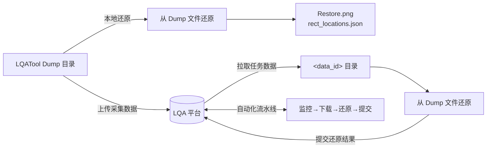
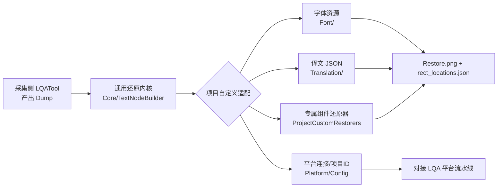

# LQARestore 插件


---

## 简介

**LQARestore** 是由 *IEG互动娱乐事业群/天美工作室群* 开发的一个 Unity 引擎插件, 是 **LQATool** 采集工具的下游还原端: 它把采集工具产出的 **Dump 数据** 反向重建为 Unity 场景中的可视文本画面, 并可对接 **LQA 平台** 实现「拉取任务数据 → 还原 → 提交检测结果」的自动化流水线, 服务于本地化 UI 质量检查。

- **上游 (LQATool)**: 在游戏运行时采集 UI 节点树、文本属性、字体、可见性与截图, 导出为 Dump JSON (含 `ScreenShot_NoText.png` 无文本背景图)。
- **本插件 (LQARestore)**: 读取 Dump, 把文本节点树 1:1 重建到还原场景中, 叠加在无文本背景图之上, 截图输出 `Restore.png`, 并导出文本框 `rect_locations.json` 供平台检测使用。

---

## 使用说明

> 本插件的所有功能都是 **Unity 编辑器菜单**, 入口统一在 `Tools/LQA/` 下, 不支持在打出的包里运行
> 使用前请确认:
> - 工程里同时导入了 **LQATool 采集插件**: `采集` 菜单会直接调用它的接口, 缺少时会编译失败
> - 已按下文「项目接入指南」完成字体、译文和专属组件的适配

### 0. 菜单总览

| 菜单 | 作用 |
| --- | --- |
| `Tools/LQA/采集/启用 LQA 采集工具` | 打开或关闭编辑器 Play 模式下的采集悬浮按钮, 菜单前的对勾表示当前状态 |
| `Tools/LQA/采集/设置 Dump 延时秒数...` | 设置点击 Dump 后等多少秒再开始采集 |
| `Tools/LQA/还原/从 Dump 文件还原` | 选一份 Dump JSON 做画面还原, 输出 `Restore.png` 和 `rect_locations.json` |
| `Tools/LQA/还原/文本显隐标记...` | 人工修正每条文本在还原时显示还是隐藏 |
| `Tools/LQA/还原/译文文件配置...` | 指定 `key→译文` JSON, 让还原结果显示译文 |
| `Tools/LQA/还原/字体变体配置...` | 按语种改写字体名 (例如泰语专用字体) |
| `Tools/LQA/平台/配置/...` | 平台连接 / 项目配置 / 任务配置 / 筛选变量 / 上传配置 / 提交配置 |
| `Tools/LQA/平台/单步/...` | 拉取任务数据 / 上传采集数据 / 提交还原结果 |
| `Tools/LQA/平台/自动化/自动化流水线...` | 按「监控 → 下载 → 还原 → 提交」自动循环 |
| `Tools/LQA/恢复默认设置...` | 一键清空本插件写入的所有配置 |


常用的三种用法:



### 1. 在编辑器里辅助采集 (可选)

在编辑器里直接 Play 采集时, 用下面两个菜单, 不用写代码改开关:

- **`启用 LQA 采集工具`**: 每点一次切换一次开/关, 状态会保存下来; 正在 Play 时 **立即生效**
  - 这个开关只改编辑器本机的 PlayerPrefs, **不影响真机包体**, 真机仍需按采集插件的方式自己开启
- **`设置 Dump 延时秒数...`**: 填一个大于等于 0 的整数, 点「保存」即生效; 0 表示立即采集


### 2. 本地还原 (单条 Dump)

#### 2.1 准备 Dump 目录

先把采集产物整个目录拷到电脑上, 确认 **同一个目录** 里有下面两个文件:

| 文件 | 是否必需 | 说明 |
| --- | --- | --- |
| `ui_data_text.json` (从平台拉下来的数据叫 `<data_id>.json`) | 必需 | 还原用的 UI 节点树 |
| `ScreenShot_NoText.png` | 强烈建议 | 没有文字的背景图; 缺了也能还原, 但背景是纯黑, Console 会提示 `未找到 ScreenShot_NoText.png, 跳过背景` |

> 还原结果会直接写回这个目录, 再次还原时同名文件会被 **覆盖**

#### 2.2 配置译文与字体变体 (可选)

- **译文**: `Tools/LQA/还原/译文文件配置...` → 点「浏览...」选好译文 JSON → 「保存」
  - 窗口下方会提示当前状态: `未配置` 表示用原文还原 / `路径不存在` 表示会退回原文 / `已配置` 表示按 keyHash 或原文匹配译文
- **字体变体**: `Tools/LQA/还原/字体变体配置...` → 填一个模板 (例如 `{name}@th`) → 「保存」
  - 模板里没有 `{name}` 占位符时, 这条配置会被忽略

两项配置都会保存在本机, 之后的每次还原 (包括自动化流水线) 都会使用, 不需要重复设置


#### 2.3 人工修正文本显隐 (可选)

采集端会按像素差异判断每条文本是否可见, 结果记在 `isVisuallyVisible` 里。如果这个判断不对, 比如被遮住的文字被还原了, 或者能看到的文字没被还原, 可以在还原前手动改:

1. `Tools/LQA/还原/文本显隐标记...` → 在弹出的对话框里选好 Dump JSON
2. 窗口会把所有文本节点平铺成一个列表:

   | 列 | 说明 |
   | --- | --- |
   | 显示 | 勾选表示还原时显示; 没有人工标记过时, 默认值等于采集端的判定结果 |
   | 原始判定 | 采集端的判定, 只读: 绿色 `✓ 可见` / 红色 `✗ 不可见` |
   | name | 节点名 |
   | textContent | 单行预览, 换行显示为 `↵`, 太长的会截断; **鼠标悬停可以看到完整原文** |

3. 用顶部「搜索」框按节点名或文本内容过滤 (不区分大小写), 然后改勾选
4. 点「保存」, 每个文本节点都会写入 `manualShow` 字段, **直接覆盖原 JSON 文件** (建议先备份)

还原时有 `manualShow` 就以它为准, 没有就看 `isVisuallyVisible`; 不勾选的节点 **连同它的子节点** 都不会被还原


#### 2.4 执行还原

1. **先保存当前场景**: 还原会新建一个场景并替换当前打开的场景, 没保存的修改会丢失
2. 菜单 `Tools/LQA/还原/从 Dump 文件还原` → 选择 Dump JSON
3. 插件会自动按顺序完成以下步骤:
   - 检查 Color Space: 如果 Dump 记录的和当前工程不一致, Console 会给出警告 (还原不中断)
   - 新建还原场景 `LQA_Restore_Scene`, 并把 Game 视图分辨率设成 Dump 里的分辨率 (会新增一个叫 `LQA_Restore` 的自定义分辨率)
   - 铺上背景图 `ScreenShot_NoText.png` (节点 `LQA_Background_Canvas`)
   - 重建可见的文本节点 (配了译文和字体变体就一起生效)
   - 截图输出 `Restore.png`, 导出文本框 `rect_locations.json`
4. 完成后 Console 会输出:

   ```
   [LQARestore][EditorSceneHost] 已保存还原画面: <Dump目录>/Restore.png
   [LQARestore][RestoreEngine] 已导出检测框: <Dump目录>/rect_locations.json (文本 N 个, 图片 M 个)
   ```


#### 2.5 还原产物

| 产物 | 位置 | 说明 |
| --- | --- | --- |
| `Restore.png` | Dump 目录 | 还原后的完整画面, 分辨率和 Dump 一致, 可以直接和 `ScreenShot_Full.png` 对比 |
| `rect_locations.json` | Dump 目录 | 平台检测用的框, 分 `text` (还原后的文本框, 带 `textStr`) 和 `image` (采集端记录的可见图片框) 两组 |
| `LQA_Restore_Scene` | 编辑器当前场景 | 没有保存的还原场景, 可以在 Hierarchy / Inspector 里逐个节点检查 |

`rect_locations.json` 格式示例 (坐标单位是屏幕像素, **原点在左下角**, 四个角按 左下 → 左上 → 右上 → 右下 排列):

```json
{
  "text": [
    {"corners":[{"x":100,"y":200},{"x":100,"y":240},{"x":300,"y":240},{"x":300,"y":200}],"textStr":"Start"}
  ],
  "image": [
    {"corners":[{"x":0,"y":0},{"x":0,"y":1080},{"x":1920,"y":1080},{"x":1920,"y":0}]}
  ]
}
```


### 3. 对接 LQA 平台

#### 3.1 首次配置 (每台机器只需一次)

按下表顺序打开 `Tools/LQA/平台/配置/` 下的各个窗口, 填好后点「保存」, 所有配置都存在本机 EditorPrefs 里, 不会进版本库

| 顺序 | 窗口 | 填写内容 | 说明 |
| --- | --- | --- | --- |
| 1 | 平台连接 | `Host` (只写协议和端口, 例如 `http://127.0.0.1:8080`)、`平台接口路径` (例如 `/api-pro`, 可空)、`数据下载路径` (可空)、`Authorization (JWT)` | 点「保存并测试连通性」检查是否能连上 |
| 2 | 项目配置 | `项目ID` | 拉取、上传、提交都要用 |
| 3 | 任务配置 | `任务 ID` | 为空或为 `0` 表示没有远程任务, 不会发起拉取 |
| 4 | 筛选变量 | `语言` (先点「拉取语言」, 再从下拉里选)、`拉取条数` (默认 1)、`最小 ID` (默认 0)、`模块 ID` (多个用 `_` 分隔, 空表示不过滤) | 拉取语言需要先配好 Host 和任务 ID; **拉取和提交都用这里选的语言码** |
| 5 | 上传配置 | `模块ID`、`资源版本` | 只在「上传采集数据」时用, 空就不带 |
| 6 | 提交配置 | `提交后触发 AI 检测` | 勾上后平台收到图片会触发 AI 检测或建 bug; 不勾只保存图和框 |

连通性测试结果的含义:

| 提示 | 含义 / 处理 |
| --- | --- |
| 连通成功 (HTTP 2xx) | 网络、服务、鉴权都正常 |
| 鉴权未通过 (302 / 401 / 403) | 能连上平台, 但 JWT 没填、填错或已过期 |
| 连接失败 | Host 填错, 或当前网络访问不到 (例如不在内网) |
| 明文 HTTP 被禁止 | 工程禁用了 HTTP: 按窗口里的步骤把 `Player Settings → Insecure HTTP Option` 改成 `Always allowed`; Unity 2022.1 及以上可以直接点「一键允许 HTTP 连接」 |
| 服务端返回 4xx/5xx | 网络是通的, 请和平台方确认服务状态 |


#### 3.2 单步模式

**A. 上传本地采集数据**

用于把 LQATool 在本地 Dump 的目录送到平台:

1. `Tools/LQA/平台/单步/上传采集数据...`
2. 点「添加目录...」选一个 Dump 目录, 或点「添加父目录(扫子目录)...」批量添加; 缺少 `ui_data_text.json` 的目录前面会显示 `⚠`, 上传时会跳过
3. 点「开始上传」, 每个目录依次执行: **建 data → 传截图 (优先用 `ScreenShot_Full.png`) → 回填模块ID / 资源版本**; 每步失败最多重试 3 次
4. 平台上的数据名就是目录名, 背景图 `ScreenShot_NoText.png` 会编码后一起传上去


**B. 拉取 → 还原 → 提交**

1. **拉取**: `Tools/LQA/平台/单步/拉取任务数据...` → 「开始拉取」, 数据按下面的结构保存:

   ```
   Application.persistentDataPath/LQAPull/Job_<任务ID>/<data_id>/
     ├── <data_id>.json          # 解码后的 Dump
     └── ScreenShot_NoText.png   # 用平台数据还原出的背景图
   ```

   拉完可以点「打开输出目录」直接跳过去
2. **还原**: 对每个 `<data_id>.json` 执行「从 Dump 文件还原」 (需要的话先做文本显隐标记)
3. **提交**: `Tools/LQA/平台/单步/提交还原结果...` → 添加还原好的目录 (必须同时有 `<data_id>.json` 和 `Restore.png`, 否则显示 `⚠` 并跳过; 没有 `rect_locations.json` 时按空框提交) → 「开始提交」
   - 语言码取「筛选变量」里选的那个, 这个窗口不能改
   - 上传后的文件名是 `<任务ID>-<data_id>-<语言码>.png`

> 注意: 本地直接 Dump 的目录 (`ui_data_text.json`) 没有平台 `data_id`, **不能直接提交**, 要先用 A 上传到平台, 再按 B 拉回来还原


#### 3.3 自动化流水线

用于值守, 把 B 流程自动循环起来:

1. `Tools/LQA/平台/自动化/自动化流水线...`
2. 确认窗口顶部只读显示的 Host / 项目ID / 任务ID / 语言码 / 筛选条件 / 译文文件都对
3. 设置参数 (只有停止状态下能改):
   - `监控间隔 (秒)`: 5 ~ 300, 默认 30
   - `还原后自动提交`: 关掉后只拉取和还原, 提交可以等人工核对后用「提交还原结果」完成
4. 点「启动流水线」; 启动前会检查 Host、任务ID、项目ID, 开了自动提交时还会检查语言码, 缺任何一项都会在日志里提示 `[错误]`, 不会启动
5. 运行中会循环执行: 拉清单 → 逐条下载 → 还原 → 提交 → 等下一轮; 单条失败最多重试 3 次, 之后跳过; 状态栏实时显示 `拉取 / 还原 / 提交 / 失败` 的数量

数据保存在 `Application.persistentDataPath/LQAAuto/Job_<任务ID>/<data_id>/`, 每条数据一个目录, 互不覆盖

> - **关闭窗口就会停止流水线**; 运行期间每处理一条都会重建还原场景, 请不要同时在编辑器里编辑场景
> - 「最小 ID」游标从筛选变量里的值开始, 每处理一条自动往后推, 但 **不会写回配置**; 重启流水线后会从筛选变量的值重新开始, 如果不想重复处理, 请先把「筛选变量 → 最小 ID」改成上次日志里最后推进到的值


### 4. 恢复默认设置

`Tools/LQA/恢复默认设置...` 会在二次确认后清空本插件的所有配置 (平台连接 / 项目 / 任务 / 筛选 / 上传 / 提交 / 译文 / 字体变体 / 采集开关 / Dump 延时), 并关闭所有打开的 LQA 窗口, **这个操作不能撤销**, 但不会删除已经生成的 Dump 和还原文件

---

## 常见问题

**Q: 还原出来的中文都是方块?**
A: 工程里找不到 Dump 记录的字体, 已经回退到默认字体 (Console 会有警告), 把项目字体放进 `Font/`, 确保字体名和 Dump 里记录的一致; 用了字体变体时, 还要确认工程里有对应的变体字体

**Q: Console 提示 `Color Space 不一致`, 还原画面偏亮或偏暗?**
A: 采集包体和当前工程的颜色空间不一样, 到 `Edit → Project Settings → Player → Other Settings → Color Space` 改成提示里 Dump 用的值, 再重新还原

**Q: 还原背景是全黑的?**
A: Dump 目录里没有 `ScreenShot_NoText.png`, 本地 Dump 请检查是不是漏拷了; 平台拉下来的数据请看日志里有没有 `无 bg_data`, 如果有, 说明上传时就没带背景图

**Q: 有些文本该显示没显示, 或者被遮住的文本也被还原了?**
A: 采集端的可见性判断有误, 用「文本显隐标记」手动改勾选, 保存后重新还原

**Q: 配了译文但还原出来还是原文?**
A: 按顺序排查: ① 「译文文件配置」窗口是否显示 `已配置` (路径失效时会退回原文); ② `TextNodeBuilder` 读 keyHash 用的组件键名和字段名是否和本项目一致; ③ Dump 里的 key 和译文表里的 key 是不是同一种算法、同一种格式

**Q: 菜单「启用 LQA 采集工具」相关代码编译报错, 找不到 `LQATool`?**
A: 本插件的采集菜单直接依赖 LQATool 采集插件, 请把两个插件一起导入工程

**Q: 连通性测试提示鉴权未通过 / 明文 HTTP 被禁止?**
A: 前者请重新获取 JWT 并粘贴到「平台连接」窗口; 后者按窗口里的引导允许 HTTP 连接, 详见「对接 LQA 平台 → 首次配置」里的结果说明

**Q: 提交或启动流水线时提示语言码无效?**
A: 语言必须用平台的数字码, 请到「筛选变量」窗口点「拉取语言」, 从下拉里选好后保存

**Q: 提交还原结果时目录前面有 `⚠`?**
A: 目录里缺少 `Restore.png` 或 `<data_id>.json` (文件名必须是纯数字), 本地 Dump 的目录不能直接提交, 要先上传再拉取

**Q: 还原后我原来打开的场景不见了?**
A: 还原会新建场景并替换当前场景, 还原前请先保存; 没保存的修改无法恢复

---

## 目录结构

| 目录 | 说明 | 是否需按项目自定义 |
| ---- | ---- | ---- |
| `Core/` | 通用还原内核: 文本节点重建 (`TextNodeBuilder`)、还原引擎 (`RestoreEngine`)、字体解析抽象 (`IFontResolver`)、场景宿主抽象 (`ISceneHost`)、翻译表 (`TranslationTable`) | 基本通用; 仅 `TextNodeBuilder` 有一处内联 keyHash 键名需按项目改 |
| `Entry/` | Unity 编辑器菜单入口 (`Tools/LQA/...`): 从 Dump 还原、文本显隐标记、配置窗口 | 否 (通用) |
| `Platform/` | 对接 LQA 平台的流水线: 拉取任务 / 上传 / 提交 / 自动化 | 流水线通用, 连接参数需按项目填 |
| `Font/` | 还原所需的字体资源 | **是**: 放入你项目自己的字体 |
| `Translation/` | 译文接入: 转换脚本 + `key→译文` JSON + 规范文档 | **是**: 按你项目的译文总表生成 |
| `Core/Runtime/ProjectCustomRestorers.cs` | 项目专属组件的还原器 | **是**: 按你项目的专属组件改写 |

---

## 项目接入指南

> `LQARestore` 采用「**通用还原内核 + 项目专属适配**」架构, 接入一个新项目, 只需关注下面 4 个自定义点, 内核 (`Core` 还原流程、`IFontResolver`/`ISceneHost` 抽象、`Platform` 流水线) 均无需改动



### 1. 放入项目字体资源 (必做)

还原文本依赖工程内存在对应字体, 否则中文会显示为方块

- 把你项目使用的字体 (`.ttf` / `.fnt` 等) 放到 `Font/` 下
- 字体解析顺序由 `Core/Editor/EditorFontResolver.cs` 实现:
  1. Dump 带 `assetPath` / `guid` → 按路径精确加载;
  2. 仅剩字体名 (如 Android 采集) → 在工程内按名反查;
  3. 查不到 → 回退内置默认字体 (并告警)
- **要点**: 只要字体名与 Dump 记录一致即可被反查命中, 不要求目录结构

### 2. 配置字体变体 (可选, 多语种时用)

当某语种使用独立字体 (如泰语专用字体) 时, 用「变体模板」按语种改写字体名:

- 菜单: `Tools/LQA/还原/字体变体配置...`
- 模板用 `{name}` 代表原字体名, 例: `{name}@th` 会把 `MyGameFont` 匹配为 `MyGameFont@th`;
- 工程内找不到变体时自动回退原字体, 保证文本始终可渲染;
- 留空 → 字体按 Dump 原样还原

### 3. 接入译文 (按语种显示译文时必做)

还原时若要显示译文而非原文, 需提供一份 `key→译文` JSON

1. 准备你项目的「译文总表」(CSV, 至少含 `键`、`原始文本`、`翻译文本 <语种>` 列);
2. 参考 `Translation/i18n_convert_spec.md` 规范, 用转换脚本生成符合 Schema 的 JSON (产物样例: `Translation/i18n_en.demo.json`);
3. 菜单 `Tools/LQA/还原/译文文件配置...` 填入生成的 JSON 路径;
4. 还原时查表顺序: `keyHash` 命中 → `original` 原文兜底匹配 → 仍无则回退原文 (见 `Core/Runtime/TranslationTable.cs`)


> **keyHash 读取点 (迁移时按需改一行)**: 上面查表用的 `keyHash`, 由 `Core/Runtime/TextNodeBuilder.cs` 中 **唯一一处内联读取** (键名 `"XxxxLocalize"` / 字段 `"keyHash"`), 这是通用内核里唯一感知项目专属键名的地方 —— 因为文本内容必须在通用 `Text`/`TMP` 还原的当下就确定, 而后处理器 (`ProjectCustomRestorers`) 晚于此执行、无法回改已写入的文本, 故只能就地内联, 换到其它项目时:
> - 本地化组件的键名/字段不同 → 只改这一行的 `"XxxxLocalize"` / `"keyHash"`;
> - 目标项目没有本地化组件 → 让 `keyHash` 取到空串即可, `_translationResolver` 会自动退化为仅按 `original` 匹配

> **接入前唯一阻塞项**: 先在游戏内 dump 一个已知节点, 确认其 key (如 `XxxxLocalize.keyHash`) 与译文总表的 key 为 **同算法、同格式**, 否则查表会静默失配

### 4. 还原项目专属组件 (有自定义组件时必做)

通用组件 (`Text` / `Canvas` / `RectTransform`) 由内核直接还原, **无需改动**, 只有项目专属组件 (如本地化标记、自定义文本特效) 需要你编写还原器, 与采集侧 (`LQATool` 的 `ProjectCustomExtractors`) 一一对应

在 `Core/Runtime/ProjectCustomRestorers.cs` 的 `RegisterAll` 中, 用 `NodePostProcessors.Register` 挂入你的还原逻辑:

```csharp
NodePostProcessors.Register((go, objectData) =>
{
    // 读取采集侧为你的专属组件导出的属性块 (键名需与采集侧一致)
    var props = objectData.Get<Dictionary<string, object>>("YourComponentKey");
    if (props == null) return;        // 该节点无此组件, 跳过

    // 把 JSON 属性还原回 Unity 组件 / 特效
    // 例如挂一个信息组件、或附加 Outline / Shadow 等
});
```

案例实现 (`XxxxLocalize` 把本地化 key 回填到 `LQAKeyInfo` 组件; `XxxxText` 用内置 `Outline`/`Shadow` 近似还原描边/阴影) 可直接参照, 替换成你项目的键名与组件即可, 单个后处理器抛异常不会中断整棵树的还原 (仅告警)

### 5. 配置平台连接与项目标识 (对接 LQA 平台时必做)

若要跑「拉取任务 → 还原 → 提交」流水线, 需填入连接信息 (均存 `EditorPrefs`, 不写入版本库):

- 平台地址 `Host` 与鉴权 `Authorization` (JWT): `Platform/Editor/Config/LqaPlatformConfig.cs`;
- 当前测试项目 `project_id`: `Platform/Editor/Config/LqaProjectConfig.cs`;
- 其余 `job_id` / 筛选 / 上传参数见 `Platform/Editor/Config/` 下对应配置

> 以上配置均为本机 `EditorPrefs`, 换机器/换账号只需重填, 不改代码, 也不会把内网地址与凭证写进源码

---

## 接入自检清单

- [ ] 项目字体已放入 `Font/`, 还原无方块
- [ ] 多语种, 字体变体模板已配置或确认无需配置
- [ ] 译文 JSON 已生成并在「译文文件配置」中指定, 且 key 格式与 Dump 一致
- [ ] `TextNodeBuilder` 中 keyHash 读取的键名/字段已对齐本项目 (无本地化组件则确认取空串)
- [ ] 项目专属组件已在 `ProjectCustomRestorers` 中注册对应还原器
- [ ] 对接平台, Host / JWT / project_id 已填写并连接测试通过

---